# Tài liệu nghiệp vụ: Sổ Hợp Tác và kết nối công ty

Dành cho chủ doanh nghiệp, giám đốc, người trình bày và người cấu hình.
Tài liệu nói **làm gì và ai làm**, không nói kỹ thuật. Cách bấm từng bước xem [Hướng dẫn sử dụng](huong-dan-su-dung.md).

**Mục lục**
1. [Tổng quan sản phẩm](#1-tổng-quan-sản-phẩm)
2. [Vai và quyền](#2-vai-và-quyền)
3. [Năm loại hợp đồng](#3-năm-loại-hợp-đồng)
4. [Quy trình duyệt, ký, gửi đối tác](#4-quy-trình-duyệt-ký-gửi-đối-tác)
5. [Trạng thái hợp đồng](#5-trạng-thái-hợp-đồng)
6. [Luật bằng chứng khi duyệt](#6-luật-bằng-chứng-khi-duyệt)
7. [Kết nối và nhắn tin giữa công ty](#7-kết-nối-và-nhắn-tin-giữa-công-ty)
8. [Cấu hình ba công ty](#8-cấu-hình-ba-công-ty)
9. [Giới hạn hiện tại](#9-giới-hạn-hiện-tại)

---

## 1. Tổng quan sản phẩm

Nền tảng gồm nhiều ứng dụng dùng chung một tài khoản. Mỗi công ty có dữ liệu riêng, công ty khác không thấy.

| Ứng dụng | Dùng để | Ai dùng |
|---|---|---|
| **Sổ Hợp Tác** | Quản lý hợp đồng, đối tác, giá, sản phẩm. Duyệt, ký, gửi hợp đồng cho đối tác | Mọi nhân viên có quyền |
| **Bảng tin** | Đăng bài, ảnh, tệp cho cả công ty; xem bài công ty đã kết nối | Mọi nhân viên |
| **Tin nhắn** | Nhắn 1-1 trong công ty và với công ty đã kết nối, kèm tệp | Mọi nhân viên có quyền Sổ Hợp Tác |
| **Chat AI** | Hỏi trợ lý AI, soạn, tóm tắt; có sẵn mục Tin nhắn | Mọi người |
| **Quản trị** | Người dùng, nhóm quyền, hồ sơ công ty, Danh bạ | Quản trị công ty |

**Kết nối công ty** cho hai công ty thấy nhau, gửi hợp đồng thẳng, nhắn tin và xem Bảng tin của nhau mà không cần hợp đồng trước.

Điều quan trọng với chủ doanh nghiệp:
- Hợp đồng **luôn qua duyệt** trước khi ra ngoài. Người duyệt phải để lại bằng chứng.
- Hợp đồng gửi đi và hợp đồng nhận về đều có quy trình sẵn, mọi công ty dùng cùng khuôn.
- Công ty khác chỉ thấy phần bạn **chủ động gửi** hoặc đã **kết nối**.

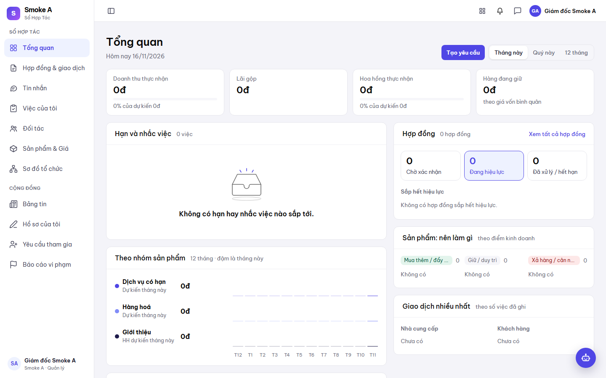

---

## 2. Vai và quyền

### 2.1. Vai trong công ty
| Vai | Làm được |
|---|---|
| **Nhân viên** | Tải hợp đồng, nhập, gửi duyệt; nhắn tin; xem Bảng tin |
| **Trưởng phòng** | Như nhân viên, và duyệt hợp đồng của người trong phòng |
| **Giám đốc** (cấp cao nhất) | Gửi hợp đồng không cần duyệt; ký; quyết nhờ đối tác ký; chọn đối tác |
| **Quản trị công ty** | Tạo người dùng, nhóm, cấp quyền, hồ sơ công ty, bật Danh bạ |

Vai theo **chức danh và sơ đồ phòng ban**. Trưởng phòng gốc (đứng đầu sơ đồ) chính là cấp cao nhất.

### 2.2. Nhóm quyền Sổ Hợp Tác
| Nhóm | Ý nghĩa |
|---|---|
| **Sổ Hợp Tác – Toàn quyền** | Xem hết, sửa cài đặt, kết nối công ty, duyệt thay khi cần |
| **Sổ Hợp Tác – Nhân viên** | Thêm, sửa hợp đồng trong phạm vi được xem |
| **Sổ Hợp Tác – Chỉ xem** | Chỉ xem, không thấy nút ghi |

Quản trị công ty cấp quyền ở **Phân quyền**.

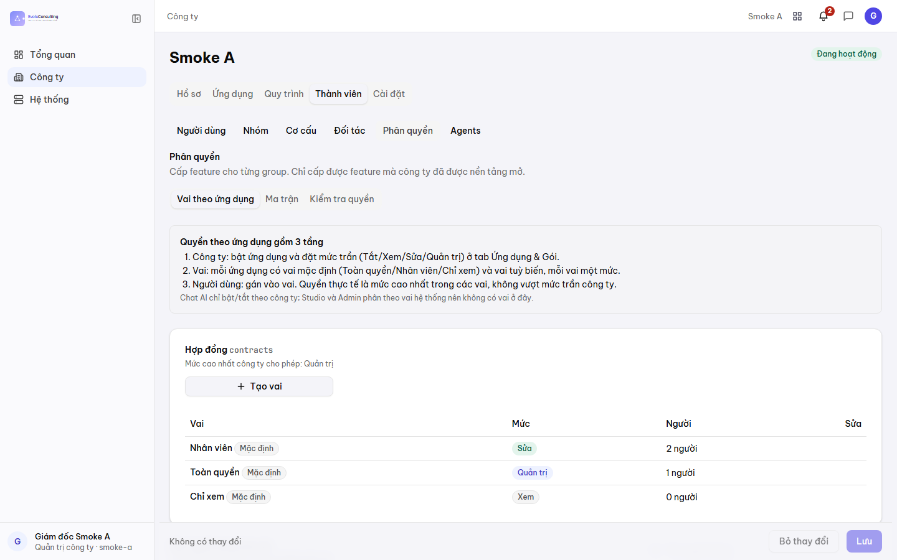

### 2.3. Ai thấy hợp đồng nào
Có hai chế độ, chọn trong Cài đặt:
- **Mọi người thấy toàn bộ**: đơn giản, hợp công ty nhỏ.
- **Theo cơ cấu**: nhân viên thấy hợp đồng mình phụ trách, của cấp dưới và của phòng mình làm trưởng. Toàn quyền thấy tất cả.

### 2.4. Ai làm được gì với đối tác
Chỉ nhóm **Toàn quyền** được gửi, nhận, ngắt lời mời kết nối. Nhắn tin thì mọi nhân viên có quyền đọc Sổ Hợp Tác đều dùng được.

---

## 3. Năm loại hợp đồng

Chọn loại khi tạo. **Không đổi được** sau khi lưu.

| Loại | Dùng khi | Điểm riêng |
|---|---|---|
| **Mua** | Công ty là bên mua hàng hoá, dịch vụ | Có bảng sản phẩm; mốc giao hàng, thanh toán; tính vào kho |
| **Bán** | Công ty là bên bán | Như Mua; tính doanh thu và lãi |
| **Giới thiệu** | Công ty giới thiệu khách, nhận hoa hồng | Có % hoa hồng; mốc nhận hoa hồng |
| **Nhượng quyền** | Công ty nhượng quyền hoặc nhận quyền thương hiệu | Thương hiệu, khu vực, độc quyền, phí ban đầu, phí định kỳ (% doanh thu hoặc cố định), phí quảng cáo, ký quỹ; nhắc báo cáo doanh thu |
| **Thỏa thuận hợp tác** | Hai bên cùng làm, chia lợi nhuận hoặc doanh thu | Mục tiêu, đóng góp mỗi bên, tỷ lệ chia, kỳ đối soát; mốc đối soát |

Nhượng quyền từ nước ngoài có thêm ô "Đã đăng ký Bộ Công Thương".

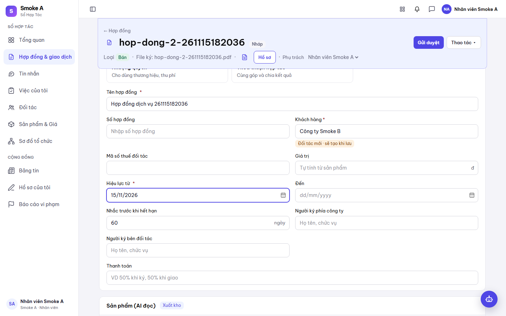

---

## 4. Quy trình duyệt, ký, gửi đối tác

Mỗi công ty có **hai quy trình**, cùng một khuôn:
1. **Duyệt hợp đồng gửi đi**: hợp đồng do công ty mình tạo.
2. **Nhận hợp đồng từ đối tác**: hợp đồng do công ty khác gửi tới.

Mỗi bước duyệt có ba lối ra: **Duyệt**, **Trả lại** (về người tạo sửa) hoặc **Từ chối** (kết thúc).

### 4.1. Hợp đồng gửi đi

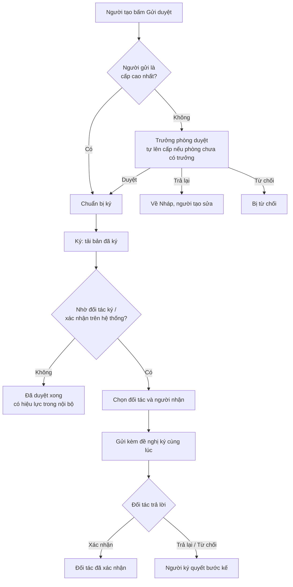

Quy tắc:
- **Nhân viên gửi** thì trưởng phòng của người đó duyệt. Phòng chưa có trưởng thì lên phòng cấp trên.
- **Cấp cao nhất gửi** thì không có bước duyệt, đi thẳng **Chuẩn bị ký**.
- **Ký** nghĩa là tải lên bản đã ký.
- Sau khi ký, người ký chọn **Có** hoặc **Không** cho câu "Nhờ đối tác ký / xác nhận trên hệ thống?".
- Chọn **Có**: người ký chọn đối tác (phải đã kết nối) và người nhận, hợp đồng gửi đi kèm lời đề nghị ký cùng lúc. Chờ tối đa 7 ngày cho đối tác trả lời.
- Chọn **Không**: các bước gửi đối tác hiện **Bỏ qua**, hợp đồng kết thúc là **Đã duyệt xong**.

Các bước của công ty hiện trên trang hợp đồng, người xem thấy ngay ai đang giữ việc.

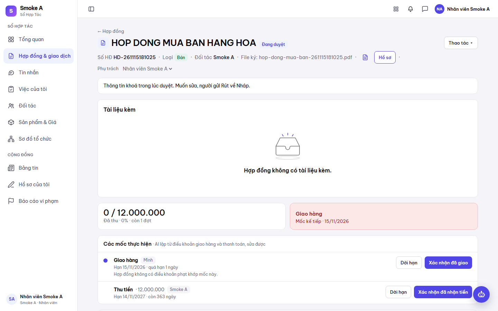

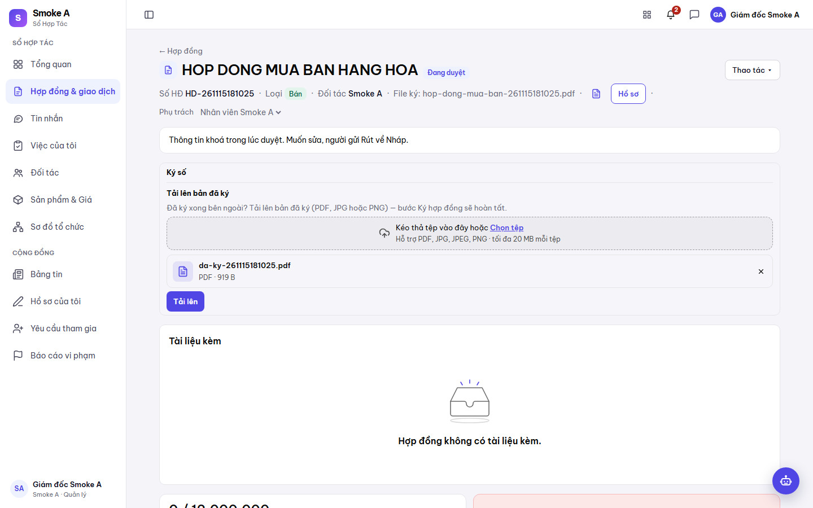

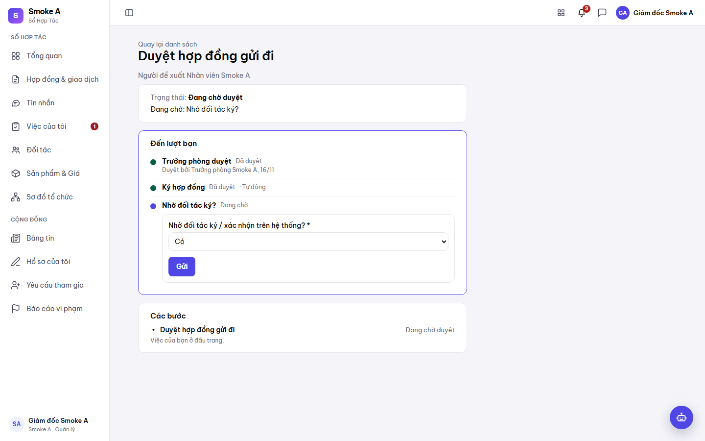

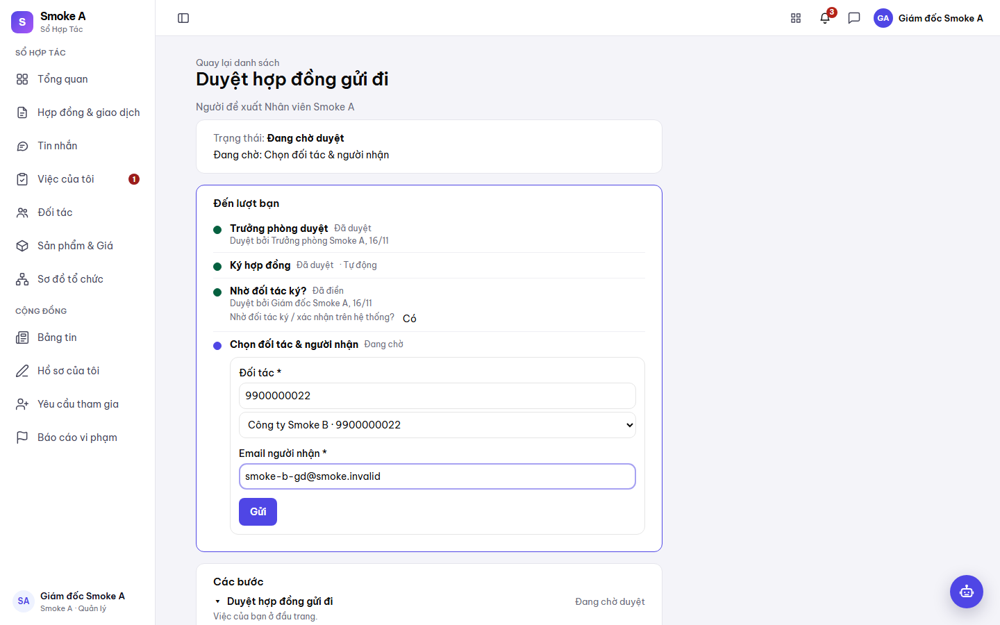

### 4.2. Nhận hợp đồng từ đối tác

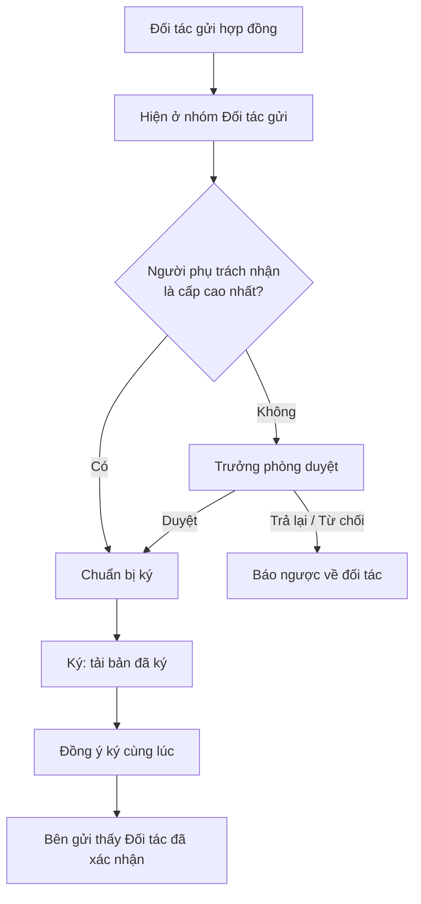

- Mỗi công ty chọn trước một **người phụ trách nhận hợp đồng**.
- Hợp đồng nhận về tự vào nhóm **Đối tác gửi**.
- Hai bên thấy cùng trạng thái, không phải báo qua điện thoại.

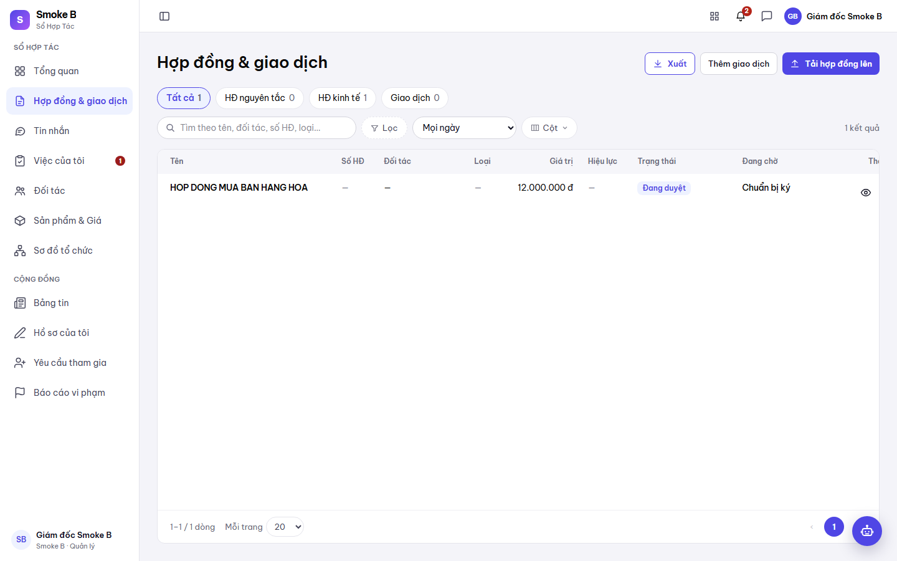

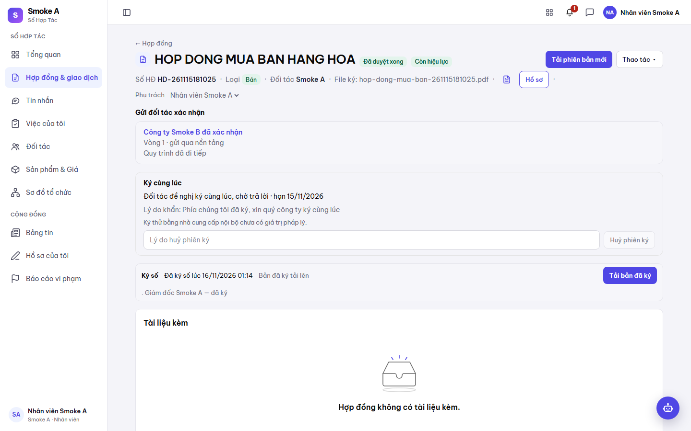

### 4.3. Khi bị Trả lại hoặc Từ chối
- Cả hai đều **bắt buộc có lý do**. Người tạo thấy lý do ngay trên hợp đồng.
- **Trả lại** đưa hợp đồng về **Nháp**. Người tạo sửa và **Gửi lại**.
- **Từ chối** kết thúc hợp đồng.

---

## 5. Trạng thái hợp đồng

| Trạng thái | Nghĩa | Ai làm bước kế |
|---|---|---|
| **Nháp** | Đang soạn hoặc vừa bị Trả lại | Người tạo |
| **Đang duyệt** | Đang qua các bước duyệt, ký, gửi đối tác | Người giữ bước hiện tại (hiện trên trang) |
| **Bị từ chối** | Người duyệt từ chối, kèm lý do | Người tạo làm hợp đồng mới nếu cần |
| **Đã duyệt xong** | Hoàn tất; có hiệu lực | Theo dõi mốc, gia hạn |

Trong trạng thái **Đang duyệt**, trên trang còn thấy: bước đang chờ, người giữ, hạn, và bước **Bỏ qua** (nhánh không đi vào).
Khi đối tác xác nhận, hợp đồng hiện thêm nhãn **Đối tác đã xác nhận**.
Thông tin hợp đồng bị khoá trong lúc duyệt. Muốn sửa phải Trả lại hoặc Rút về.

Hợp đồng đã duyệt xong có mốc (giao hàng, thanh toán, hoa hồng, gia hạn…) hiện ở **Tổng quan** và **Cần xử lý**.

---

## 6. Luật bằng chứng khi duyệt

Mỗi lần bấm **Duyệt** cần **cả hai**:
1. **Ý kiến** bằng chữ.
2. **Chữ ký hoặc tệp đính kèm** (ví dụ biên bản, ảnh đã ký).

Lý do: người duyệt xác nhận trách nhiệm, sau này ai cũng truy được "ai duyệt, vì sao".

Cách làm cho người duyệt: bấm **Duyệt** ở đầu trang thì ô bằng chứng mở ngay, con trỏ nằm sẵn ở ô ý kiến, nói rõ cần "ý kiến + chữ ký hoặc tệp". Nút xác nhận trong ô ghi **Duyệt**, nút **Huỷ** đứng riêng.

Luật đi kèm:
- Người gửi hợp đồng **không tự duyệt** bước của mình.
- Bước duyệt quá hạn thì nhắc và có thể **leo cấp** lên người cấp trên.
- Trả lại và Từ chối bắt buộc có lý do, không cần chữ ký.
- Toàn quyền duyệt thay được khi người duyệt vắng. Lượt duyệt thay được ghi rõ.

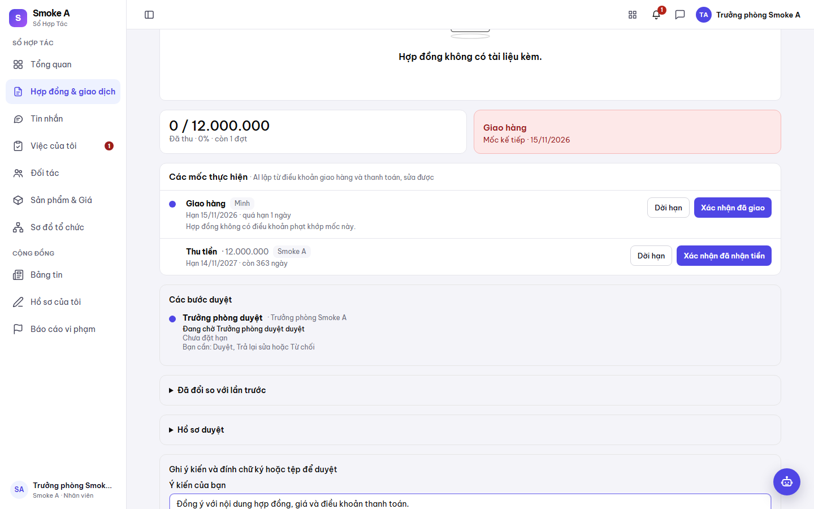

---

## 7. Kết nối và nhắn tin giữa công ty

### 7.1. Danh bạ
Công ty muốn được tìm thấy phải bật **Danh bạ** (cần tên pháp nhân và mã số thuế). Chưa bật thì công ty khác không tìm, không mời được.

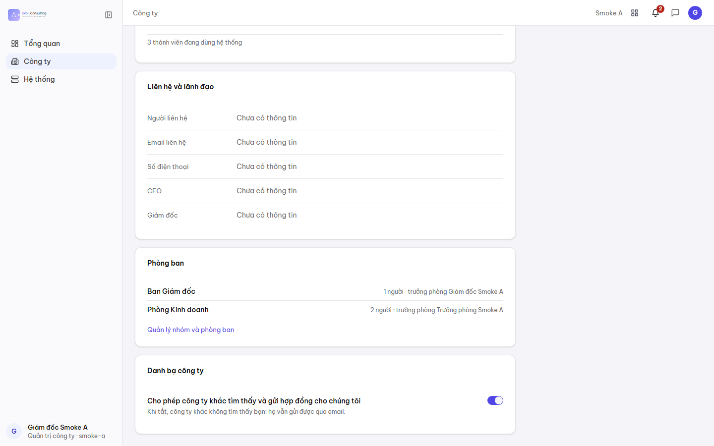

### 7.2. Kết nối
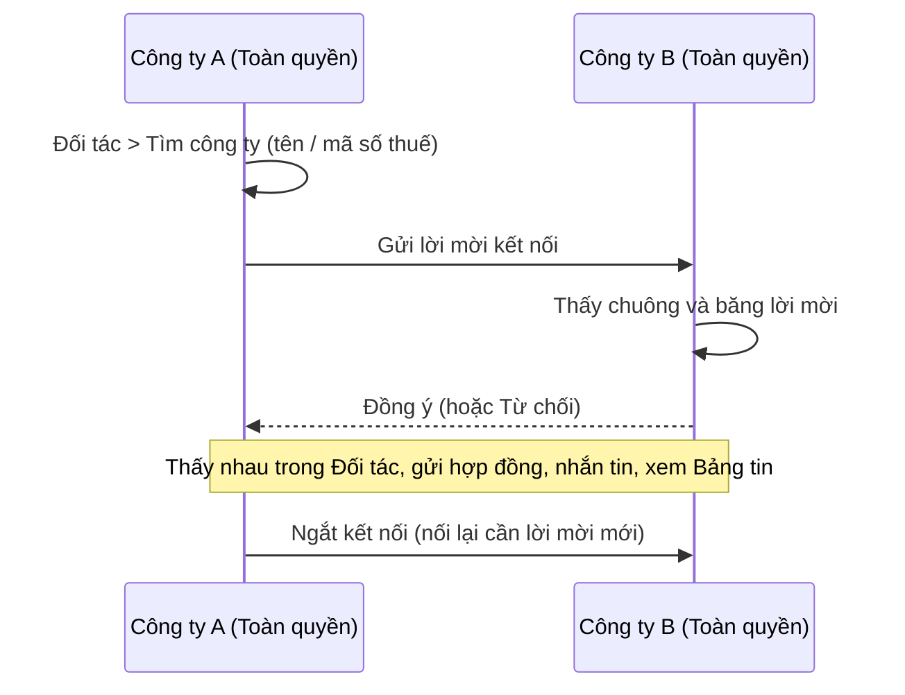

- Từ chối nghĩa là chặn. Công ty gửi mời sẽ thấy bị chặn, không mời lại được cho tới khi bên kia mở.
- Ngắt kết nối: mất quyền gửi hợp đồng thẳng; tin nhắn cũ vẫn đọc được nhưng không nhắn thêm.

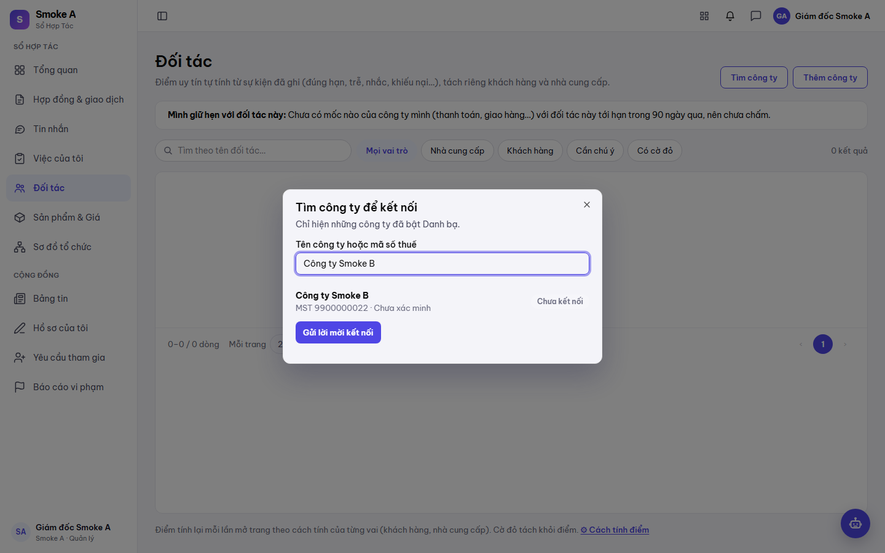

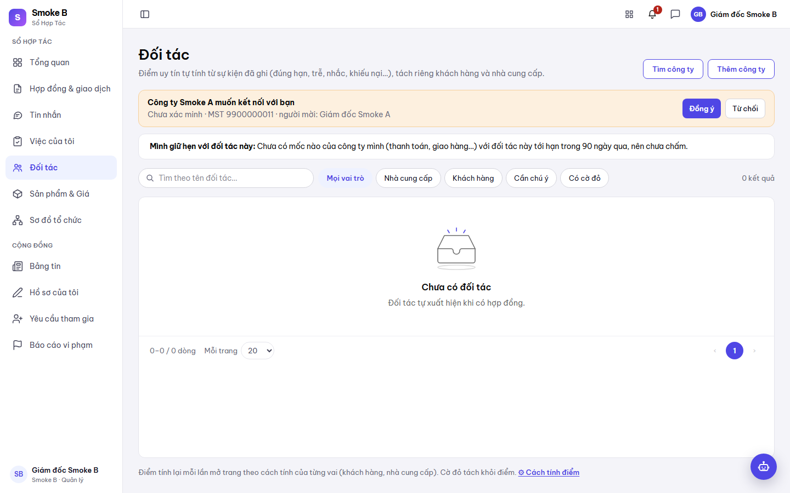

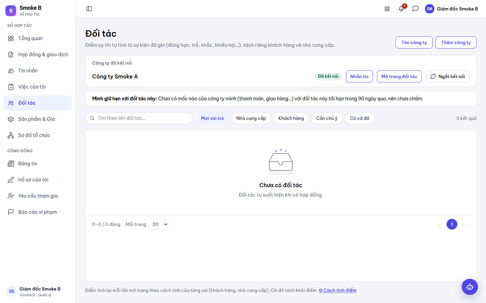

### 7.3. Trang đối tác
Mỗi đối tác có 3 tab: **Tổng quan** (điểm uy tín: **TỐT**, **KHÁ**, **CHÚ Ý**), **Hợp đồng**, **Sổ việc & ghi chú**.

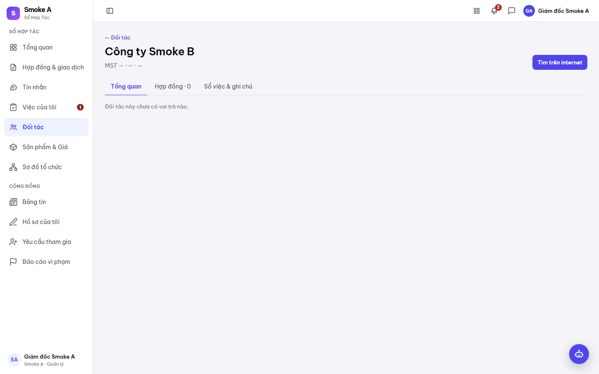

### 7.4. Tin nhắn giữa công ty
- Mọi nhân viên của hai công ty đã kết nối nhắn 1-1 được cho nhau, kể cả đính tệp.
- Danh sách mặc định hiện người nhắn gần đây. Lọc theo công ty: **Tất cả**, công ty mình, từng công ty đã kết nối.
- Tìm người theo tên hoặc chức vụ. Mỗi người kèm tên công ty.
- Chỉ thấy tên và chức vụ người công ty kia. Không lộ email, điện thoại, phòng ban.
- Người gửi thu hồi được tin của mình.
- **Trợ lý AI không đọc và không gửi tin nhắn.**
- Lọc theo công ty đó còn xem được **Bảng tin** của họ.
- Tin nhắn có trong Sổ Hợp Tác và trong Chat AI, cùng một dữ liệu.

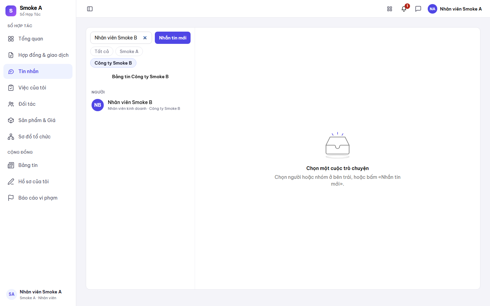

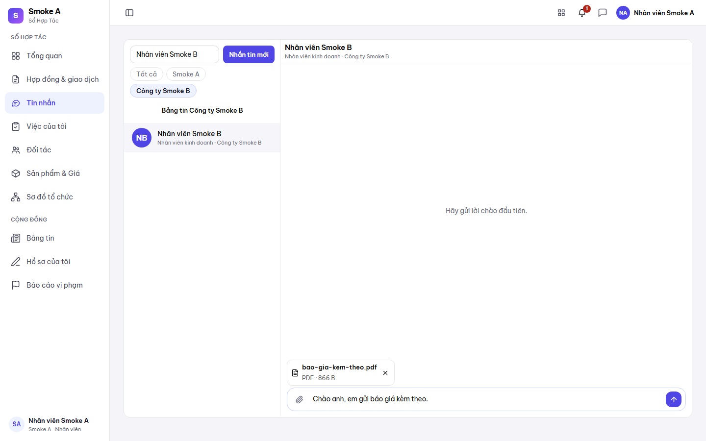

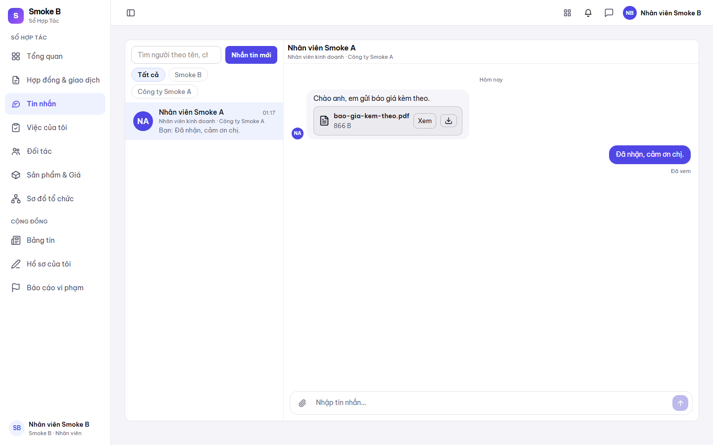

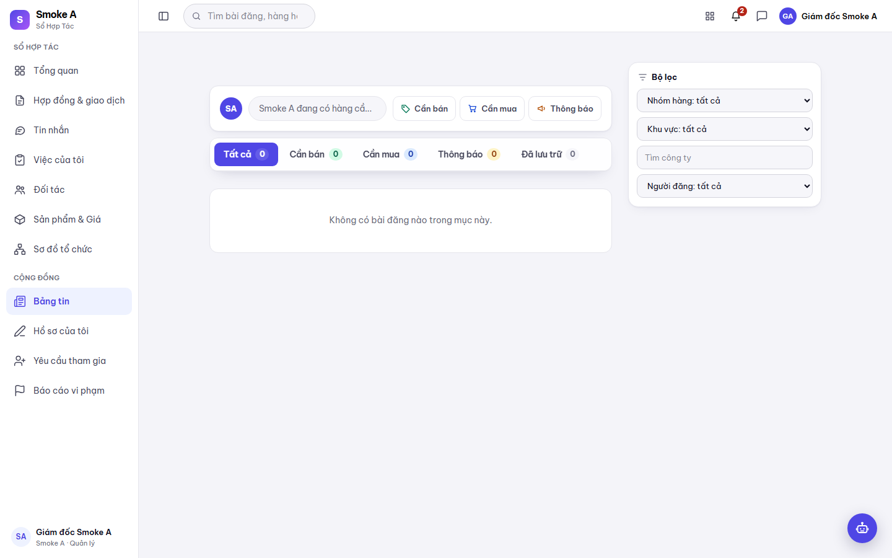

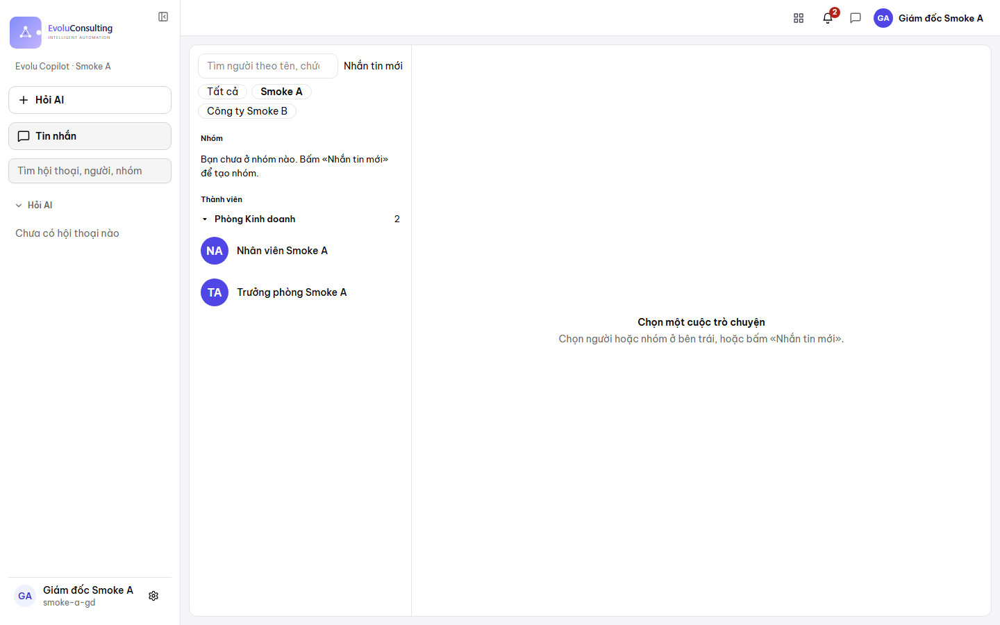

---

## 8. Cấu hình ba công ty

Ba công ty dùng cùng khuôn quy trình. Khác nhau ở **người** và **phòng ban**.
Cả ba đều bật Sổ Hợp Tác, Bảng tin, "Gửi và nhận hợp đồng với đối tác" và Danh bạ.

Mật khẩu do quản trị cấp, không ghi trong tài liệu.

### 8.1. Evolu (công ty chủ)
| Phòng | Trưởng phòng |
|---|---|
| **Ban Giám đốc** (gốc) | Thomas Tran, Giám đốc |
| **Phòng Kinh doanh** | Julian Bui |
| **Phòng Chăm sóc khách hàng** | Rowan Hoang |
| **Phòng Kỹ thuật** | Vio Ngo |
| **Phòng R&D** | Edgar Nguyen |

| Việc | Ai làm |
|---|---|
| Duyệt hợp đồng gửi đi | Trưởng phòng của người gửi; Thomas là cấp cao nhất |
| Chuẩn bị ký, Ký, Nhờ đối tác ký, chọn đối tác | Thomas Tran |
| Nhận hợp đồng từ đối tác | Julian Bui phụ trách; Thomas duyệt và ký |
| Quản trị công ty | Thomas Tran, Julian Bui |

### 8.2. NitiGroup
| Phòng | Trưởng phòng / thành viên |
|---|---|
| **Phòng Giám đốc** (gốc) | Lê Thị Thủy Tiên, Giám đốc; Lê Thị Thủy Ngân, Phó giám đốc |
| **Phòng Kinh doanh** | Chưa có trưởng; Trang Thúy Vy, nhân viên |
| **Phòng Nhân sự** | HR, trưởng phòng |
| **Phòng Vận hành** | Admin, trưởng phòng |
| **Phòng Kế toán** | Phạm Huỳnh Thu Phương, phó phòng |

| Việc | Ai làm |
|---|---|
| Duyệt hợp đồng gửi đi | Trưởng phòng của người gửi (Phòng Kinh doanh chưa có trưởng thì lên Phòng Giám đốc) |
| Chuẩn bị ký, Ký, Nhờ đối tác ký, chọn đối tác | Lê Thị Thủy Tiên |
| Nhận hợp đồng từ đối tác | Lê Thị Thủy Tiên (cấp cao nhất: Chuẩn bị ký rồi Ký) |
| Quản trị công ty | Lê Thị Thủy Tiên, Admin |

### 8.3. Preschool
| Phòng | Trưởng phòng |
|---|---|
| **Ban Giám đốc** (gốc) | Dung Dang, Giám đốc |

Chỉ có một người, nên mọi hợp đồng đi thẳng **Chuẩn bị ký** rồi **Ký**.

| Việc | Ai làm |
|---|---|
| Duyệt hợp đồng gửi đi | Không có bước duyệt (cấp cao nhất) |
| Chuẩn bị ký, Ký, Nhờ đối tác ký, chọn đối tác | Dung Dang |
| Nhận hợp đồng từ đối tác | Dung Dang |
| Quản trị công ty | Dung Dang |

Khi thêm người hoặc phòng mới, quản trị cập nhật sơ đồ. Quy trình tự theo sơ đồ.

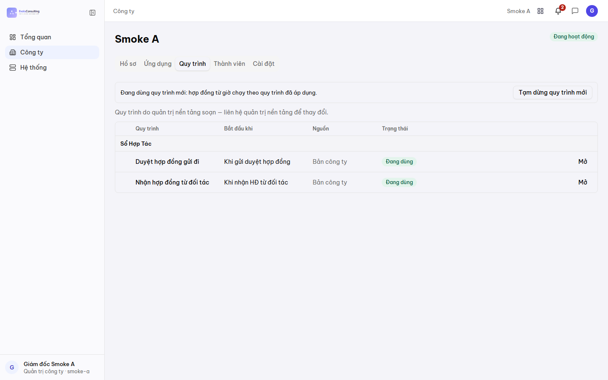

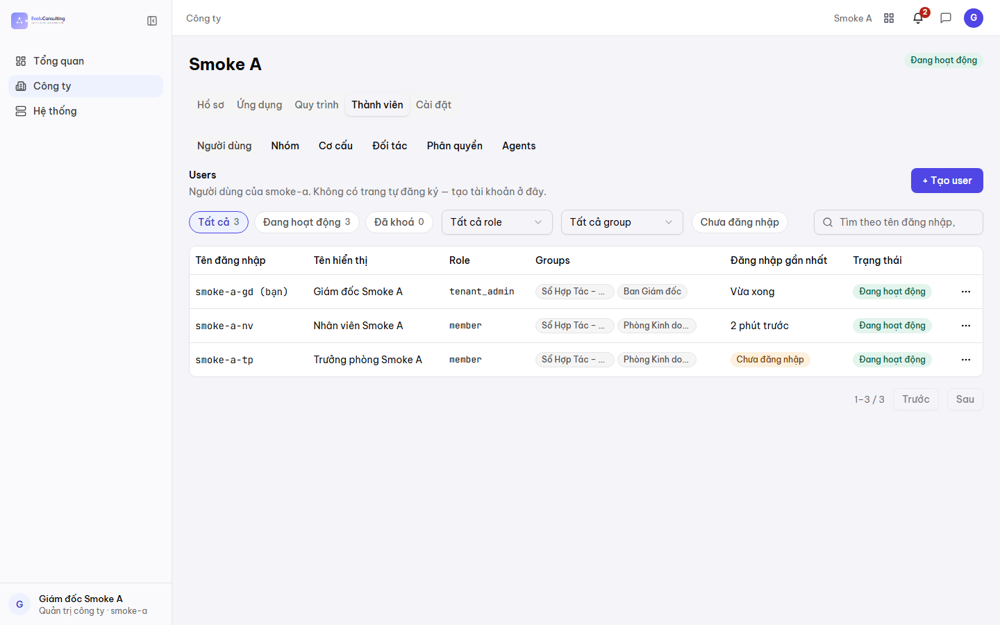

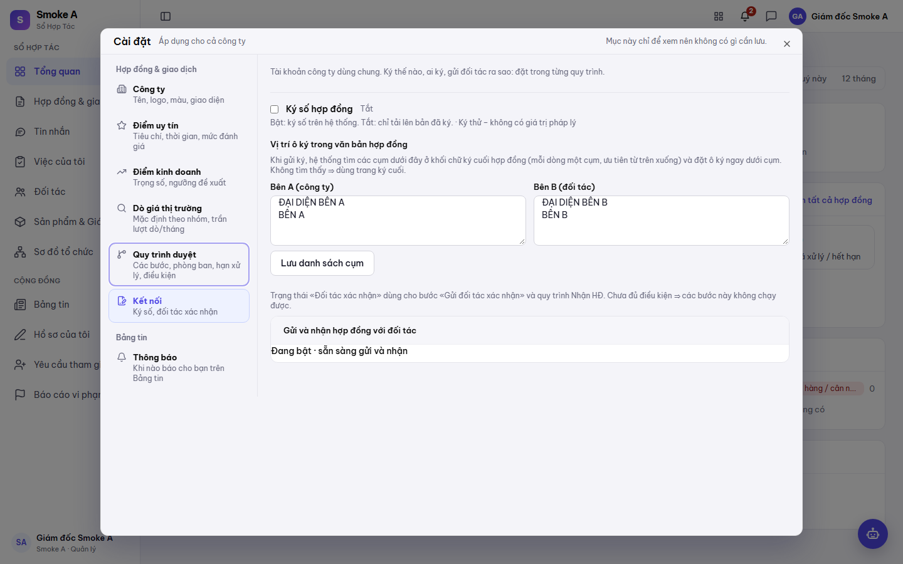

---

## 9. Giới hạn hiện tại

| Mục | Tình trạng | Cách xử lý tạm |
|---|---|---|
| **Ký số thật** | Chưa bật. "Ký" là tải lên bản đã ký | Ký ngoài hệ thống rồi tải lên |
| **Gửi email** | Đang tắt. Thông báo chỉ ở chuông trong ứng dụng | Nhắc nhau qua Tin nhắn |
| **Mục Yêu cầu** (phiếu đề nghị mua hàng, thanh toán) | Đang ẩn, sẽ định nghĩa lại sau | Chưa dùng |
| **Đối tác ngoài hệ thống** | Chưa nhận xác nhận trên hệ thống | Gửi qua đường ký cũ |
| **Tin nhắn nhóm nhiều công ty** | Chưa có | Nhắn 1-1 |
| **Trợ lý AI với Tin nhắn** | Cố ý không đọc, không gửi | Không áp dụng |
| **Mã số thuế của công ty mẫu** | Đang là số tạm, cần xác nhận | Báo khi có số thật |

Mọi mục ở trên là quyết định có chủ ý của giai đoạn này, không phải lỗi.
