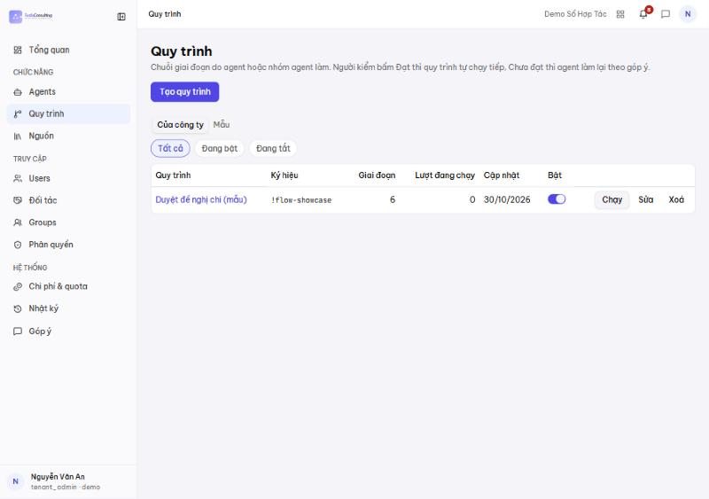
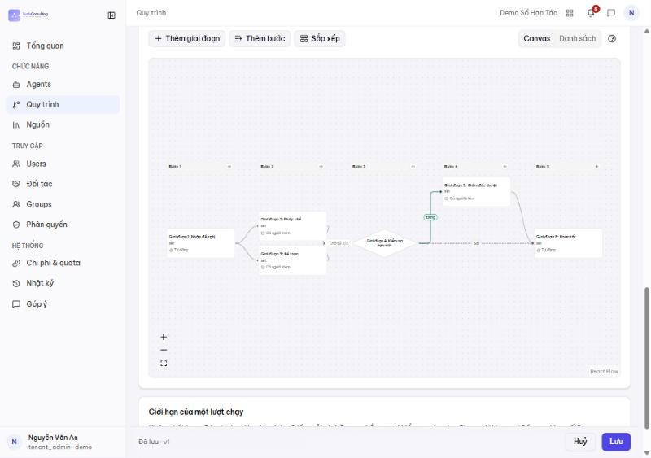
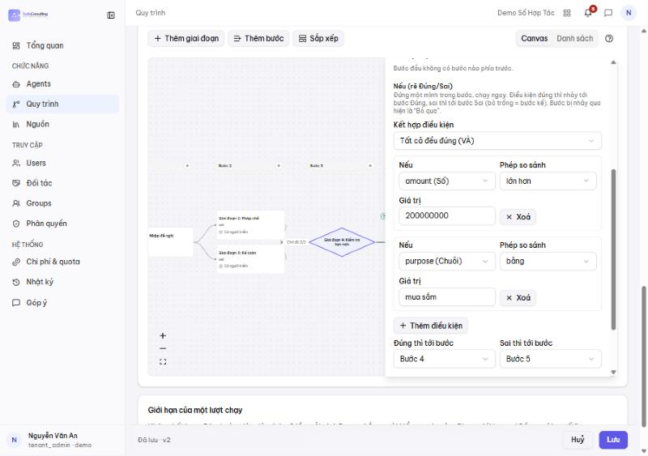
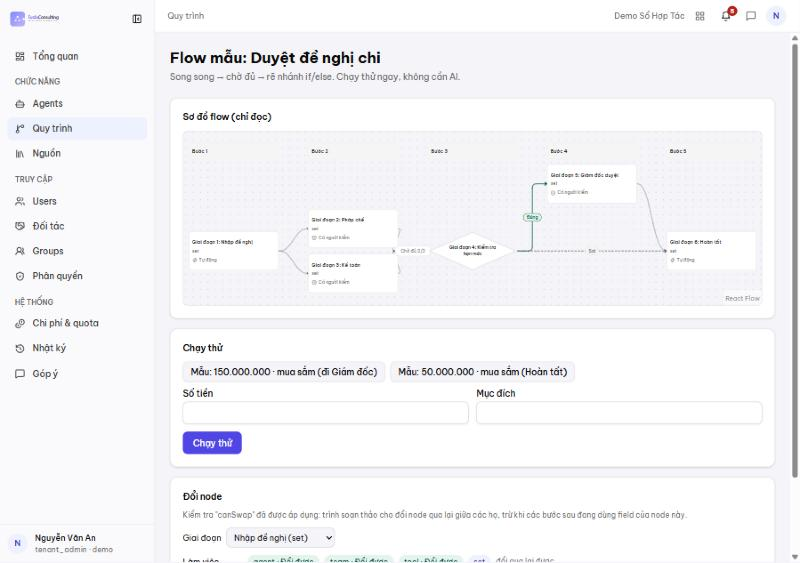
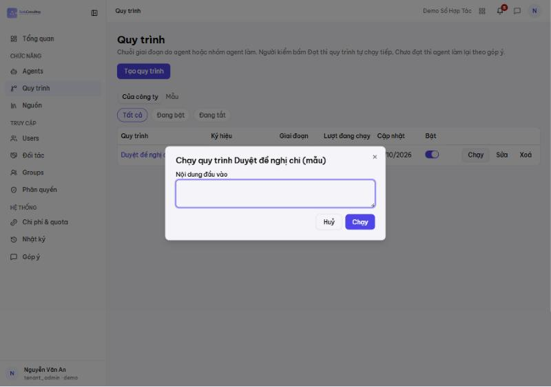
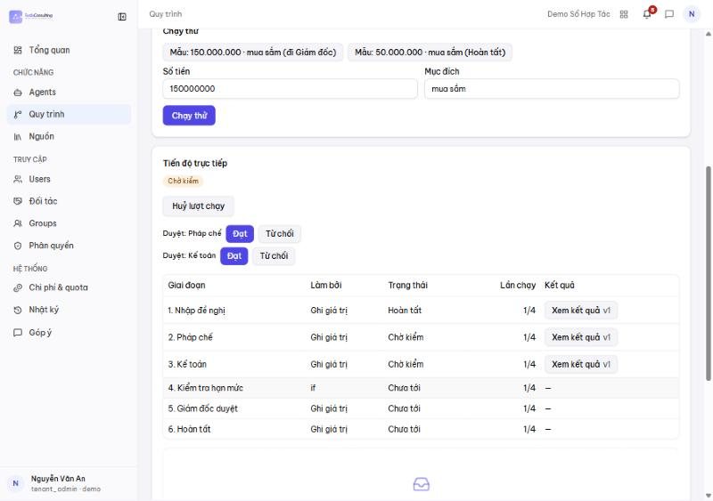
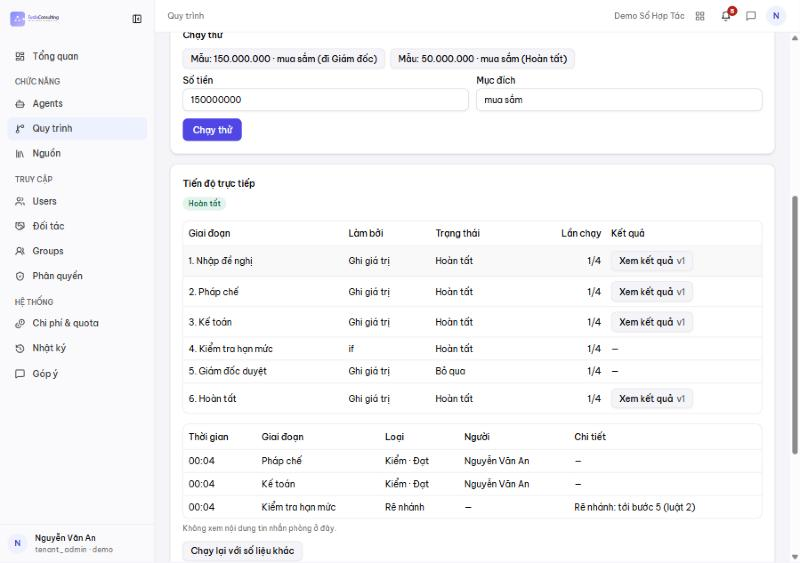
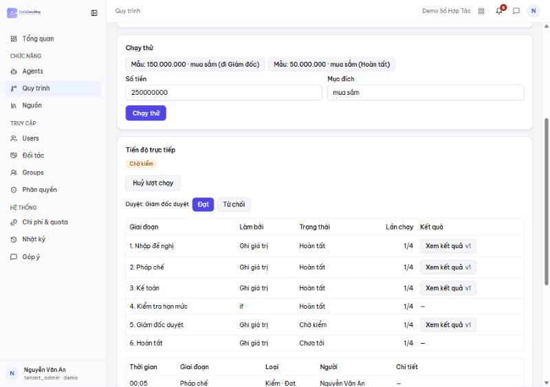
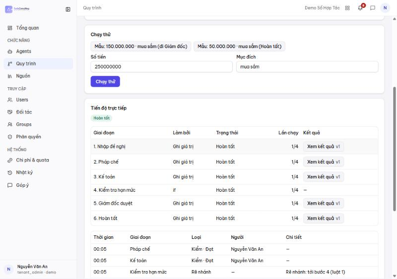

# Sửa quy trình duyệt hợp đồng và áp dụng lên engine

Hướng dẫn cho quản trị công ty (chủ gói Sổ Hợp Tác). Ảnh chụp trên máy dev (`scripts/dev-up.ps1 -SeedDemo`, tài khoản
`julian.bui` / tenant `evolu`) ngày 30/10/2026.

## Tóm tắt — sửa ở đâu?

| | Form **Cài đặt › Quy trình duyệt** (Sổ Hợp Tác) | **Canvas** ai-admin › Quy trình › "Duyệt hợp đồng" |
|---|---|---|
| Vai trò | **Nguồn gốc** của quy trình duyệt HĐ | Bản đã biên dịch (process def `contracts-approval`) mà engine chạy |
| Ai sửa | Chủ gói Sổ Hợp Tác (owner) | tenant_admin / platform_admin |
| Sửa được gì | Bước, phòng ban, người duyệt, hạn xử lý, nhắc lại, chuyển cấp, điều kiện (loại HĐ, giá trị), bước Ký số | Mọi thứ của engine (tên giai đoạn, nhánh, nút hệ thống…) |
| Lưu xong | Biên dịch lại toàn bộ ⇒ def **phiên bản mới** trên engine | Def phiên bản mới trên engine |
| Bền không | Có | **Không** — lần lưu form kế tiếp **ghi đè** mọi sửa trên canvas |

**Quy tắc:** quy trình duyệt hợp đồng **luôn sửa ở form Cài đặt**. Canvas dùng để **xem** quy trình đã biên dịch
(kiểm tra đường đi, nhánh) và để soạn các quy trình khác (vd "Duyệt đề nghị chi"). Đã kiểm thật: sửa tên giai đoạn trên canvas
(def v2) rồi lưu lại form không đổi gì ⇒ def v3 trả về tên theo form.

Vì sao: form dùng điều kiện riêng của Sổ Hợp Tác (`FlowWhen`: loại HĐ Mua/Bán/Giới thiệu, ngưỡng giá trị) và các nút hệ thống
(`contracts-route` chọn bước kế, `contracts-finalize` ghi "Đã duyệt") — form sinh chúng tự động. Sửa tay trên canvas dễ làm hỏng
các nút này. Nguồn: ADR-0030, `docs/current/sht/duyet-ky-so.md`, `docs/specs/contract-flow/tasks.md`.

## Điều kiện để chạy trên engine

Cả hai phải bật, thiếu một ⇒ hợp đồng vẫn duyệt bằng **máy 2 bước cũ** (form vẫn lưu được nhưng không có tác dụng):

1. Env hub-api `CONTRACTS_APPROVAL_ENGINE=on` (công tắc khẩn toàn hệ thống).
2. Công ty có feature **`contracts-approval-engine`** (ai-admin › Features, platform_admin cấp).

Máy dev: `scripts/dev-up.ps1` bật sẵn cả hai cho `evolu` và `demo`. Prod: hiện chỉ tenant `demo` có feature.

## Các bước

### 1. Mở Cài đặt

Sổ Hợp Tác › bấm tên mình (góc dưới trái) › **Cài đặt**.

### 2. Vào tab "Quy trình duyệt"

Công ty chưa lưu lần nào ⇒ nhãn **"Dùng mặc định"** (2 bước dựng từ cài đặt duyệt cũ), phiên bản `v1`.
Bước 1 "Soạn & kiểm tra" luôn chạy, không có điều kiện.

Mỗi bước có:

| Trường | Ý nghĩa |
|---|---|
| Tên bước | Hiện trên thẻ duyệt và trong thông báo |
| Phòng ban | Group được giao bước này |
| Người duyệt cụ thể | Trống = ai trong phòng cũng duyệt được; chọn người = chỉ người đó |
| Hạn xử lý (giờ) | Quá hạn ⇒ nhắc / chuyển cấp |
| Nhắc lại mỗi (giờ, 4–168) | Nhắc lặp tới khi xử lý |
| Chuyển cấp cho nhóm | Quá hạn ⇒ giao thêm cho nhóm này |
| Chỉ trưởng phòng duyệt | Chỉ trưởng phòng của phòng ban được bấm |
| Người gửi không được duyệt bước này | Chặn tự duyệt HĐ của chính mình |
| Điều kiện áp dụng | Loại HĐ (Mua/Bán/Giới thiệu) và/hoặc giá trị (≥, >, ≤, <); **giá trị trống thì vẫn cần bước** |

### 3. Sửa — ví dụ thêm bước "Giám đốc duyệt" cho HĐ ≥ 1 tỷ

Cuộn xuống › **Thêm bước duyệt** ⇒ bước 3 trống (báo đỏ tới khi điền tên + phòng ban).

Điền: tên "Giám đốc duyệt", phòng ban, người duyệt cụ thể, hạn 48 giờ › **Thêm điều kiện** › tick **Giá trị** `≥ 1000000000`.

Các nút ↑ ↓ đổi thứ tự bước, **Xoá bước** để bỏ. **Thêm bước Ký số** thêm bước ký số sau duyệt (cần cấu hình ký số ở dưới).

### 4. Kiểm bằng "Xem trước đường đi" trước khi lưu

Chọn loại HĐ + nhập giá trị mẫu ⇒ thấy bước nào **chạy** / **bỏ qua**:

- 300 triệu ⇒ chỉ bước 1; bước 2 (≥ 500tr) và 3 (≥ 1 tỷ) bỏ qua.

  
- 1,5 tỷ ⇒ chạy đủ 3 bước (ảnh ở bước 3 phía trên).

### 5. Lưu ⇒ áp dụng lên engine

Bấm **Lưu quy trình** ⇒ thông báo "Đã lưu quy trình duyệt", phiên bản tăng (`v2`), mất nhãn "Dùng mặc định".

Ngay khi lưu, hub-api biên dịch form thành process def `contracts-approval` (phiên bản mới) — không cần deploy hay restart.

**Áp dụng cho HĐ nào:**
- Lượt duyệt **mở sau khi lưu** ⇒ chạy theo phiên bản mới.
- Lượt **đang chạy** ⇒ chạy nốt theo phiên bản lúc mở (không đổi giữa chừng).

### 6. Xem quy trình đã biên dịch trên canvas (ai-admin)

ai-admin › **Quy trình** ⇒ dòng **"Duyệt hợp đồng"** (`!contracts-approval`). Số giai đoạn = các bước duyệt + nút hệ thống.

Mở ra › phần **Giai đoạn** › **Canvas** (bấm **Sắp xếp** cho gọn): Kiểm tra hợp đồng → Chọn bước kế (`contracts-route`, rẽ
nhánh theo điều kiện) → Duyệt cấp 2 → Giám đốc duyệt → Ghi Đã duyệt (`contracts-finalize`). Đường nét đứt = rẽ nhánh / quay lại
khi bị trả.

### 7. (Không khuyến nghị) Sửa trực tiếp trên canvas

Bấm một giai đoạn ⇒ ngăn bên phải sửa được tên, người thực hiện, bước, quay lại khi bị trượt… › **Lưu** ⇒ def phiên bản mới,
engine dùng ngay cho lượt mới.

Nhưng: form Cài đặt **không** thấy thay đổi này, và lần **Lưu quy trình** kế tiếp ở form sẽ biên dịch lại và **ghi đè**. Chỉ dùng
canvas để sửa nhanh tạm thời; muốn giữ thì sửa lại ở form.

## Danh sách ai-admin › Quy trình có nhiều quy trình — cái nào duyệt hợp đồng?

Chỉ **một**: **"Duyệt hợp đồng" (`!contracts-approval`)**. Sổ Hợp Tác tự mở lượt chạy quy trình này khi một HĐ vào duyệt; không ai
bấm "Chạy" tay. Nó được sinh từ form Cài đặt › Quy trình duyệt (xuất hiện sau lần **Lưu quy trình** đầu tiên của công ty).

Các quy trình khác trong danh sách **không** dùng để duyệt hợp đồng:

| Quy trình | Ký hiệu | Từ đâu | Dùng làm gì |
|---|---|---|---|
| Sửa lỗi (AISDLC) | `!bug-fix` | mẫu seed máy dev (`HUB_SEED_FIXTURES=1`, `apps/hub-api/seed/processes.full.yaml`) | quy trình AI sửa lỗi phần mềm; chạy tay |
| Giao tính năng (AISDLC) | `!sdlc-delivery` | như trên | quy trình AI giao tính năng; chạy tay |
| Duyệt đề nghị chi (mẫu) | `!flow-showcase` | `seed-flow-showcase.ts` (tenant `demo`, `-SeedDemo`) | trình diễn engine (rẽ nhánh `if`, `set`); chạy tay ở `/processes/showcase` |

Muốn đổi cách duyệt hợp đồng ⇒ chỉ sửa form Cài đặt (mục 3–5). Tắt hoặc xoá các quy trình mẫu ở trên không ảnh hưởng duyệt HĐ.

## Quy trình tự soạn trên canvas — ví dụ "Duyệt đề nghị chi (mẫu)"

Khác duyệt HĐ: với các quy trình này **canvas là nguồn gốc** (không có form nào ghi đè). Sửa trên canvas › **Lưu** ⇒ phiên bản
mới, áp dụng ngay cho lượt chạy mở sau đó (lượt đang chạy giữ phiên bản cũ). Chạy **tay** — Sổ Hợp Tác không tự kích hoạt.
Ảnh chụp với `demo-owner` (tenant `demo`, `-SeedDemo`), 31/10/2026.

### A. Mở quy trình

ai-admin › **Quy trình** › bấm tên "Duyệt đề nghị chi (mẫu)" (hoặc **Sửa**).

Phần **Giai đoạn** › **Canvas** › **Sắp xếp**: Nhập đề nghị (`set`, tự động) → Pháp chế ∥ Kế toán (**song song**, người kiểm) →
"Chờ đủ 2/2" → **Kiểm tra hạn mức** (`if`, hình thoi) → Đúng: Giám đốc duyệt → Hoàn tất; Sai: thẳng Hoàn tất.

Phần **Trường nhập** (phía trên canvas) khai báo dữ liệu lượt chạy: `amount` (Số), `purpose` (Chữ) — điều kiện `if` dùng các
trường này.

### B. Sửa và áp dụng — ví dụ nâng ngưỡng Giám đốc từ 100 lên 200 triệu

Bấm nút **Kiểm tra hạn mức** ⇒ ngăn bên phải: kết hợp điều kiện (VÀ / HOẶC), từng điều kiện (trường, phép so sánh, giá trị),
"Đúng thì tới bước" / "Sai thì tới bước". Mặc định: `amount > 100000000` **VÀ** `purpose = mua sắm` ⇒ Bước 4.

Đổi giá trị thành `200000000` › **Lưu** (góc dưới phải) ⇒ "Đã lưu · v2".

Các thao tác khác trên canvas: bấm giai đoạn để đổi tên / người thực hiện / bước / quay lại khi bị trượt; **Thêm giai đoạn**,
**Thêm bước**; cùng một "bước" = chạy song song (tối đa 3); đổi loại node trong cùng họ ở mục "Đổi node" của trang chạy thử.

### C. Cách chạy

**Cách 1 — trang Chạy thử (có ô cho từng trường), dùng cho quy trình mẫu này:** mở `http://localhost:3000/processes/showcase`
(prod: `https://ai-admin.<domain>/processes/showcase`). Nhập **Số tiền**, **Mục đích** (hoặc bấm nút mẫu) › **Chạy thử**.
Nhãn nút mẫu ("đi Giám đốc") viết theo bản gốc 100 triệu — sau khi sửa ngưỡng, kết quả thật có thể khác nhãn.

**Cách 2 — nút "Chạy" ở danh sách Quy trình:** chỉ có một ô "Nội dung đầu vào" (văn bản tự do), **không** có ô `amount` /
`purpose` ⇒ không dùng được cho quy trình cần trường nhập như mẫu này (điều kiện `if` sẽ không có số để so). Dùng cho quy trình
chỉ cần một đoạn mô tả.

**Theo dõi và duyệt:** khối **Tiến độ trực tiếp** hiện trạng thái từng giai đoạn; bước có người kiểm hiện nút **Đạt / Từ chối**
— chỉ người thuộc Group được giao bước đó mới bấm được.

> **Đây là chạy thử, không phải duyệt thật.** Để một người tự bấm hết đường đi, `seed-flow-showcase.ts` (cờ `--admin`, mặc định
> `demo-owner`) **cố ý** thêm `demo-owner` vào cả 3 Group duyệt (Kinh doanh/Pháp chế, Kế toán, Ban Giám đốc). Vì vậy ảnh dưới đây
> một tài khoản duyệt được mọi phòng. Dùng thật: mỗi Group chỉ có người của phòng đó (ai-admin › Groups), người khác **không**
> thấy nút Đạt. Lưu ý thêm: khi hub ở chế độ `HUB_PROCESS_ROUTES=admin` (prod hiện tại) chỉ tenant_admin/platform_admin gọi được
> hộp việc duyệt, nên người duyệt của các quy trình này cũng phải là admin — đó là giới hạn của chế độ admin, không phải thiết kế
> cuối. Bảng dưới là nhật ký: ai duyệt, lúc
nào, rẽ nhánh tới bước nào. **Huỷ lượt chạy** để dừng; **Chạy lại với số liệu khác** để thử tiếp.

### D. Kết quả kiểm thật sau khi sửa (v2, ngưỡng 200 triệu)

| Lượt | Số tiền · Mục đích | Đường đi | Ảnh |
|---|---|---|---|
| 1 | 150.000.000 · mua sắm | Pháp chế ∥ Kế toán (Đạt) → `if` **Sai** (150tr ≤ 200tr) → Giám đốc **Bỏ qua** → Hoàn tất; nhật ký "Rẽ nhánh: tới bước 5 (luật 2)" | 07, 08 |
| 2 | 250.000.000 · mua sắm | Pháp chế ∥ Kế toán (Đạt) → `if` **Đúng** → **chờ Giám đốc duyệt** → Đạt → Hoàn tất; nhật ký "Rẽ nhánh: tới bước 4 (luật 1)" | 09, 10 |

Ở bản v1 (100 triệu), lượt 1 đã phải qua Giám đốc ⇒ bản sửa đã áp dụng ngay, không cần deploy.

### E. Muốn dùng thật cho đề nghị chi

Đừng sửa thẳng bản mẫu: **Tạo quy trình** (hoặc tab **Mẫu**) để có quy trình riêng, đặt tên, trường nhập, Group duyệt thật, rồi
soạn trên canvas như trên. Bản mẫu nên giữ nguyên để trình diễn (seed chỉ tạo khi chưa có, không ghi lại).

## Hỏi đáp

- **Lưu rồi mà HĐ vẫn duyệt kiểu cũ?** Kiểm 2 điều kiện ở mục "Điều kiện để chạy trên engine".
- **Không thấy menu "Quy trình" trong ai-admin?** Chỉ tenant_admin / platform_admin thấy; giao diện tiếng Anh là "Processes".
- **Bỏ sửa chưa lưu?** Nút **Bỏ thay đổi** cạnh **Lưu quy trình**. (Nút **Khôi phục tất cả** ở đầu Cài đặt áp cho mọi tab —
  chưa kiểm nó có đưa quy trình duyệt về mặc định hay không.)
- **Người trong phòng ban lấy từ đâu?** Group của công ty (ai-admin › Groups); phòng ban thật tạo bằng onboarding (vd
  `deploy/tenants/demo.yaml`).
