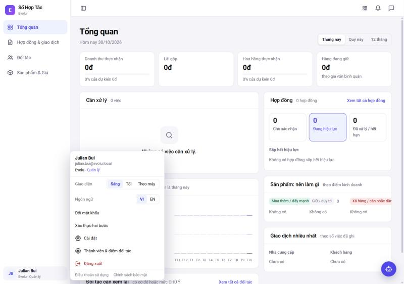
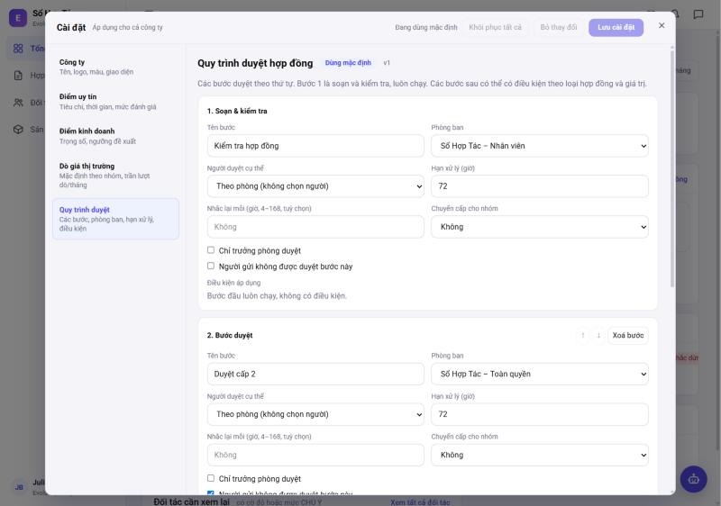
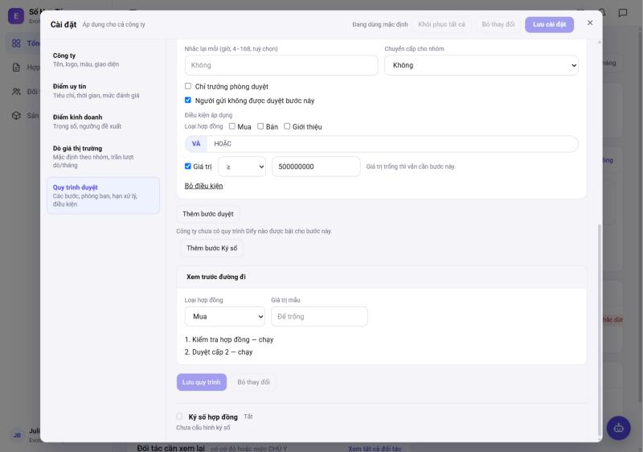
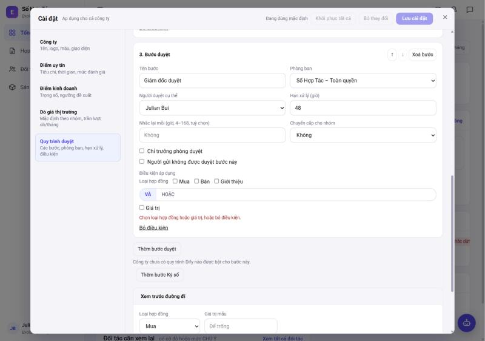
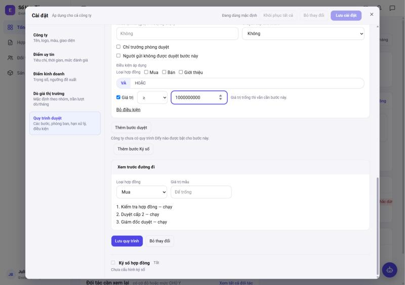
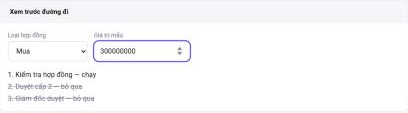
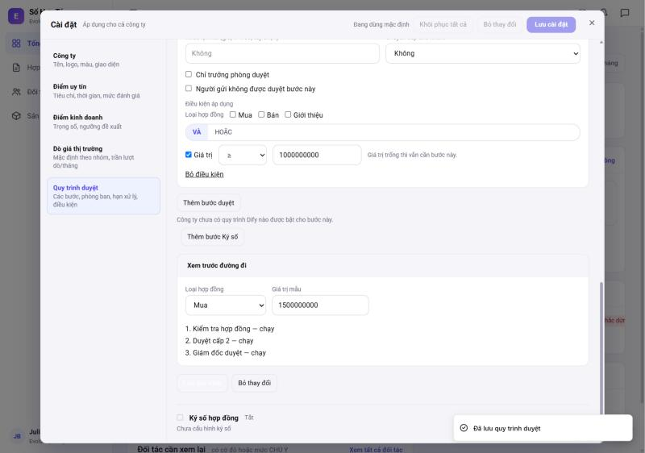
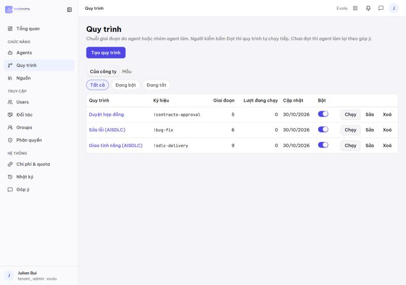
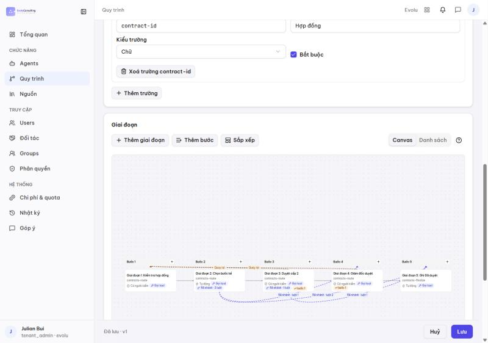
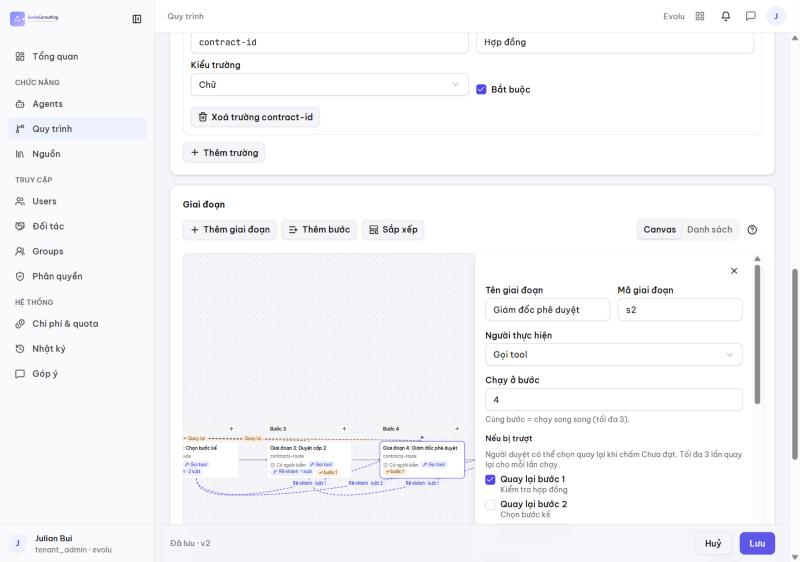

# Sửa quy trình duyệt hợp đồng và áp dụng lên engine

Hướng dẫn cho quản trị công ty (chủ gói Sổ Hợp Tác). Ảnh chụp trên máy dev (`scripts/dev-up.ps1 -SeedDemo`, tài khoản
`julian.bui` / tenant `evolu`) ngày 30/10/2026.

## Tóm tắt — sửa ở đâu?

| | Form **Cài đặt › Quy trình duyệt** (Sổ Hợp Tác) | **Canvas** ai-admin › Quy trình › "Duyệt hợp đồng" |
|---|---|---|
| Vai trò | **Nguồn gốc** của quy trình duyệt HĐ | Bản đã biên dịch (process def `contracts-approval`) mà engine chạy |
| Ai sửa | Chủ gói Sổ Hợp Tác (owner) | tenant_admin / platform_admin |
| Sửa được gì | Bước, phòng ban, người duyệt, hạn xử lý, nhắc lại, chuyển cấp, điều kiện (loại HĐ, giá trị), bước Ký số | Mọi thứ của engine (tên giai đoạn, nhánh, nút hệ thống…) |
| Lưu xong | Biên dịch lại toàn bộ ⇒ def **phiên bản mới** trên engine | Def phiên bản mới trên engine |
| Bền không | Có | **Không** — lần lưu form kế tiếp **ghi đè** mọi sửa trên canvas |

**Quy tắc:** quy trình duyệt hợp đồng **luôn sửa ở form Cài đặt**. Canvas dùng để **xem** quy trình đã biên dịch
(kiểm tra đường đi, nhánh) và để soạn các quy trình khác (vd "Duyệt đề nghị chi"). Đã kiểm thật: sửa tên giai đoạn trên canvas
(def v2) rồi lưu lại form không đổi gì ⇒ def v3 trả về tên theo form.

Vì sao: form dùng điều kiện riêng của Sổ Hợp Tác (`FlowWhen`: loại HĐ Mua/Bán/Giới thiệu, ngưỡng giá trị) và các nút hệ thống
(`contracts-route` chọn bước kế, `contracts-finalize` ghi "Đã duyệt") — form sinh chúng tự động. Sửa tay trên canvas dễ làm hỏng
các nút này. Nguồn: ADR-0030, `docs/current/sht/duyet-ky-so.md`, `docs/specs/contract-flow/tasks.md`.

## Điều kiện để chạy trên engine

Cả hai phải bật, thiếu một ⇒ hợp đồng vẫn duyệt bằng **máy 2 bước cũ** (form vẫn lưu được nhưng không có tác dụng):

1. Env hub-api `CONTRACTS_APPROVAL_ENGINE=on` (công tắc khẩn toàn hệ thống).
2. Công ty có feature **`contracts-approval-engine`** (ai-admin › Features, platform_admin cấp).

Máy dev: `scripts/dev-up.ps1` bật sẵn cả hai cho `evolu` và `demo`. Prod: hiện chỉ tenant `demo` có feature.

## Các bước

### 1. Mở Cài đặt

Sổ Hợp Tác › bấm tên mình (góc dưới trái) › **Cài đặt**.

### 2. Vào tab "Quy trình duyệt"

Công ty chưa lưu lần nào ⇒ nhãn **"Dùng mặc định"** (2 bước dựng từ cài đặt duyệt cũ), phiên bản `v1`.
Bước 1 "Soạn & kiểm tra" luôn chạy, không có điều kiện.

Mỗi bước có:

| Trường | Ý nghĩa |
|---|---|
| Tên bước | Hiện trên thẻ duyệt và trong thông báo |
| Phòng ban | Group được giao bước này |
| Người duyệt cụ thể | Trống = ai trong phòng cũng duyệt được; chọn người = chỉ người đó |
| Hạn xử lý (giờ) | Quá hạn ⇒ nhắc / chuyển cấp |
| Nhắc lại mỗi (giờ, 4–168) | Nhắc lặp tới khi xử lý |
| Chuyển cấp cho nhóm | Quá hạn ⇒ giao thêm cho nhóm này |
| Chỉ trưởng phòng duyệt | Chỉ trưởng phòng của phòng ban được bấm |
| Người gửi không được duyệt bước này | Chặn tự duyệt HĐ của chính mình |
| Điều kiện áp dụng | Loại HĐ (Mua/Bán/Giới thiệu) và/hoặc giá trị (≥, >, ≤, <); **giá trị trống thì vẫn cần bước** |

### 3. Sửa — ví dụ thêm bước "Giám đốc duyệt" cho HĐ ≥ 1 tỷ

Cuộn xuống › **Thêm bước duyệt** ⇒ bước 3 trống (báo đỏ tới khi điền tên + phòng ban).

Điền: tên "Giám đốc duyệt", phòng ban, người duyệt cụ thể, hạn 48 giờ › **Thêm điều kiện** › tick **Giá trị** `≥ 1000000000`.

Các nút ↑ ↓ đổi thứ tự bước, **Xoá bước** để bỏ. **Thêm bước Ký số** thêm bước ký số sau duyệt (cần cấu hình ký số ở dưới).

### 4. Kiểm bằng "Xem trước đường đi" trước khi lưu

Chọn loại HĐ + nhập giá trị mẫu ⇒ thấy bước nào **chạy** / **bỏ qua**:

- 300 triệu ⇒ chỉ bước 1; bước 2 (≥ 500tr) và 3 (≥ 1 tỷ) bỏ qua.

  
- 1,5 tỷ ⇒ chạy đủ 3 bước (ảnh ở bước 3 phía trên).

### 5. Lưu ⇒ áp dụng lên engine

Bấm **Lưu quy trình** ⇒ thông báo "Đã lưu quy trình duyệt", phiên bản tăng (`v2`), mất nhãn "Dùng mặc định".

Ngay khi lưu, hub-api biên dịch form thành process def `contracts-approval` (phiên bản mới) — không cần deploy hay restart.

**Áp dụng cho HĐ nào:**
- Lượt duyệt **mở sau khi lưu** ⇒ chạy theo phiên bản mới.
- Lượt **đang chạy** ⇒ chạy nốt theo phiên bản lúc mở (không đổi giữa chừng).

### 6. Xem quy trình đã biên dịch trên canvas (ai-admin)

ai-admin › **Quy trình** ⇒ dòng **"Duyệt hợp đồng"** (`!contracts-approval`). Số giai đoạn = các bước duyệt + nút hệ thống.

Mở ra › phần **Giai đoạn** › **Canvas** (bấm **Sắp xếp** cho gọn): Kiểm tra hợp đồng → Chọn bước kế (`contracts-route`, rẽ
nhánh theo điều kiện) → Duyệt cấp 2 → Giám đốc duyệt → Ghi Đã duyệt (`contracts-finalize`). Đường nét đứt = rẽ nhánh / quay lại
khi bị trả.

### 7. (Không khuyến nghị) Sửa trực tiếp trên canvas

Bấm một giai đoạn ⇒ ngăn bên phải sửa được tên, người thực hiện, bước, quay lại khi bị trượt… › **Lưu** ⇒ def phiên bản mới,
engine dùng ngay cho lượt mới.

Nhưng: form Cài đặt **không** thấy thay đổi này, và lần **Lưu quy trình** kế tiếp ở form sẽ biên dịch lại và **ghi đè**. Chỉ dùng
canvas để sửa nhanh tạm thời; muốn giữ thì sửa lại ở form.

## Hỏi đáp

- **Lưu rồi mà HĐ vẫn duyệt kiểu cũ?** Kiểm 2 điều kiện ở mục "Điều kiện để chạy trên engine".
- **Không thấy menu "Quy trình" trong ai-admin?** Chỉ tenant_admin / platform_admin thấy; giao diện tiếng Anh là "Processes".
- **Bỏ sửa chưa lưu?** Nút **Bỏ thay đổi** cạnh **Lưu quy trình**. (Nút **Khôi phục tất cả** ở đầu Cài đặt áp cho mọi tab —
  chưa kiểm nó có đưa quy trình duyệt về mặc định hay không.)
- **Người trong phòng ban lấy từ đâu?** Group của công ty (ai-admin › Groups); phòng ban thật tạo bằng onboarding (vd
  `deploy/tenants/demo.yaml`).
