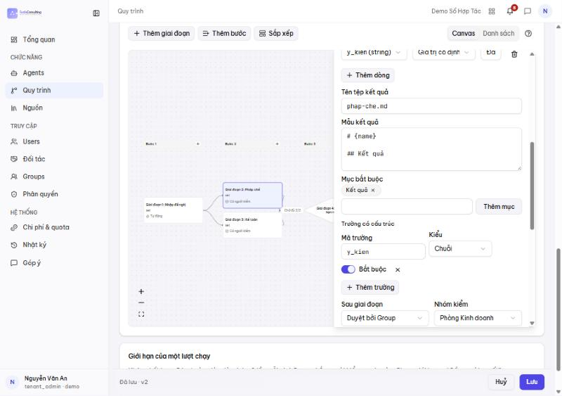
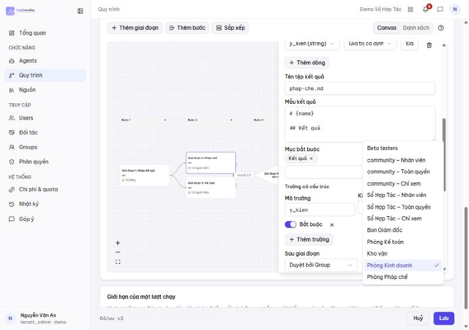
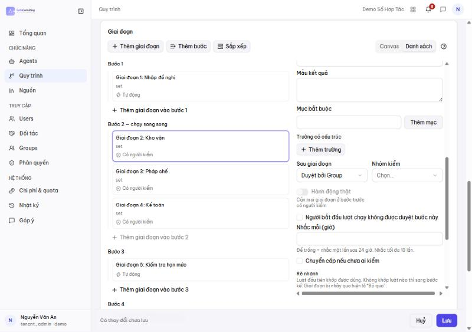
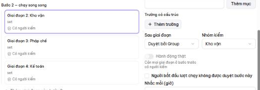
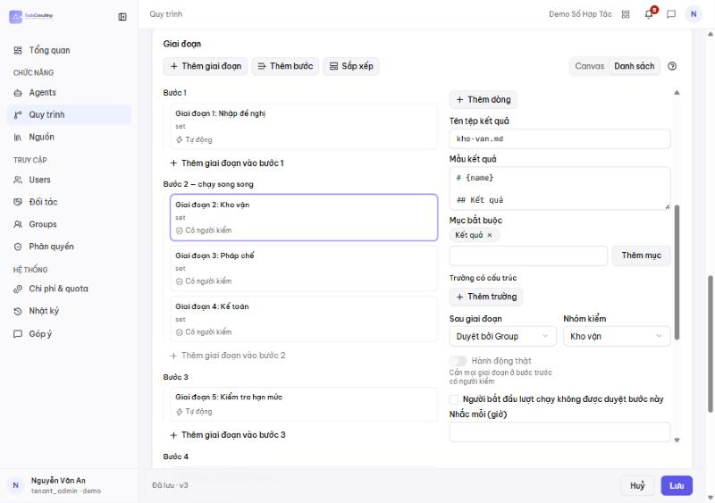
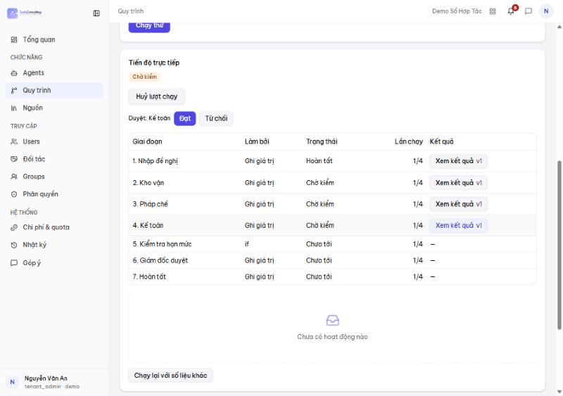
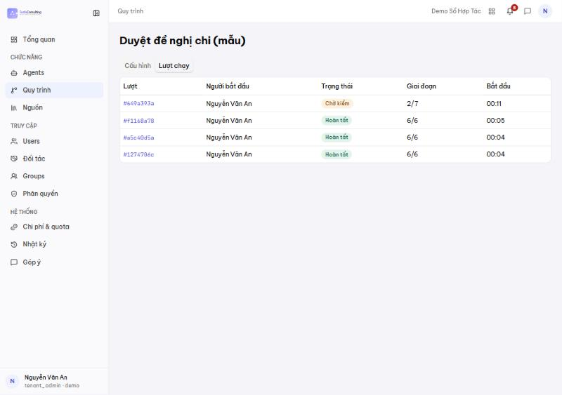

# Quy trình duyệt hợp đồng: thư viện quy trình

Hướng dẫn cho platform admin (ai-admin) và chủ gói Sổ Hợp Tác. Từ CR-105, quy trình duyệt HĐ không còn soạn ở form
**Cài đặt › Quy trình duyệt** của Sổ Hợp Tác và không còn bị form ghi đè trên canvas. Nguồn: `docs/current/engine/thu-vien-quy-trinh.md`,
`docs/current/sht/duyet-ky-so.md` §1c.

## Luồng mới

Thao tác ở ai-admin (chỉ platform_admin): **Quy trình › Thư viện**.

1. **Nhân bản** quy trình có sẵn (kể cả quy trình mặc định hoặc đang dùng) thành nháp mới cùng khe "Sổ Hợp Tác · Duyệt hợp đồng"; chưa gán cho ai.
2. **Sửa** nháp bằng nút **Canvas** hoặc **Form** (cùng dữ liệu). Nút hệ thống (`contracts-route`, `contracts-finalize`) bị khoá. Khe này chỉ nhận dạng tuần tự; canvas song song bị từ chối (`SLOT_SHAPE_UNSUPPORTED`). Dùng **Xem trước đường đi** (loại HĐ + giá trị mẫu) để kiểm bước chạy/bỏ qua.
3. **Xuất bản**: hệ thống kiểm (đủ nút hệ thống, không bước không tới được, mọi tenant đang dùng đủ phòng ban theo mã) và hiện tác động (số tenant, số lượt đang chạy). Chỉ bản xuất bản được chạy; sửa nháp chưa xuất bản không đổi lượt mới. Có **Lịch sử** và **Quay lại** (tạo bản mới bằng nội dung bản cũ).
4. **Gán cho tenant** (trong thư viện hoặc trên trang tenant). Mỗi tenant một quy trình cho khe này. Tenant thiếu phòng ban theo mã ⇒ 422 `SLOT_GROUPS_MISSING`.

**Quy trình mặc định:** đúng một quy trình mặc định cho khe, nhãn "Mặc định · Sổ Hợp Tác · Duyệt hợp đồng". Tenant chưa gán chạy mặc định (tra lại mỗi lần mở lượt). Mặc định không xoá/tắt được; platform admin đổi sang quy trình đã xuất bản khác. Onboarding tenant có thể ghi sẵn `approval_process: <ký hiệu>` trong yaml.

**Áp dụng cho HĐ nào:** lượt duyệt mở sau khi xuất bản/gán chạy theo bản mới; lượt đang chạy giữ snapshot lúc mở.

**Trong Sổ Hợp Tác:** Cài đặt › Quy trình duyệt chỉ hiện "Quy trình duyệt đang dùng: <tên> · v<N>" (sơ đồ chỉ xem + xem trước) và link sang editor; không còn nút lưu luồng.

## Điều kiện để chạy trên engine

Thiếu một ⇒ HĐ duyệt bằng máy 2 bước cũ:

1. Env hub-api `CONTRACTS_APPROVAL_ENGINE=on`.
2. Công ty có feature `contracts-approval-engine` (ai-admin › Features).

## Ảnh cũ, sẽ chụp lại

Các ảnh dưới đây chụp form Cài đặt cũ (30/10/2026), không còn khớp giao diện hiện hành; giữ tạm để tham khảo cấu trúc bước.

## Danh sách ai-admin › Quy trình có nhiều quy trình — cái nào duyệt hợp đồng?

Quy trình duyệt HĐ nằm ở **Quy trình › Thư viện** (khe `contracts.approval`), gán theo tenant hoặc dùng mặc định; Sổ Hợp Tác tự mở lượt khi HĐ vào duyệt, không ai bấm "Chạy" tay. Các quy trình khác trong danh sách **không** dùng để duyệt hợp đồng (mẫu chạy thử nằm ở tab "Mẫu · chạy thử", lượt chạy thử có cờ `is_test` và ẩn khỏi danh sách lượt mặc định):
| Quy trình | Ký hiệu | Từ đâu | Dùng làm gì |
|---|---|---|---|
| Sửa lỗi (AISDLC) | `!bug-fix` | mẫu seed máy dev (`HUB_SEED_FIXTURES=1`, `apps/hub-api/seed/processes.full.yaml`) | quy trình AI sửa lỗi phần mềm; chạy tay |
| Giao tính năng (AISDLC) | `!sdlc-delivery` | như trên | quy trình AI giao tính năng; chạy tay |
| Duyệt đề nghị chi (mẫu) | `!flow-showcase` | `seed-flow-showcase.ts` (tenant `demo`, `-SeedDemo`) | trình diễn engine (rẽ nhánh `if`, `set`); chạy tay ở `/processes/showcase` |

## Quy trình tự soạn trên canvas — ví dụ "Duyệt đề nghị chi (mẫu)"

Khác duyệt HĐ: với các quy trình này **canvas là nguồn gốc** (không có form nào ghi đè). Sửa trên canvas › **Lưu** ⇒ phiên bản
mới, áp dụng ngay cho lượt chạy mở sau đó (lượt đang chạy giữ phiên bản cũ). Chạy **tay** — Sổ Hợp Tác không tự kích hoạt.
Ảnh chụp với `demo-owner` (tenant `demo`, `-SeedDemo`), 31/10/2026.

### A. Mở quy trình

ai-admin › **Quy trình** › bấm tên "Duyệt đề nghị chi (mẫu)" (hoặc **Sửa**).

Phần **Giai đoạn** › **Canvas** › **Sắp xếp**: Nhập đề nghị (`set`, tự động) → Pháp chế ∥ Kế toán (**song song**, người kiểm) →
"Chờ đủ 2/2" → **Kiểm tra hạn mức** (`if`, hình thoi) → Đúng: Giám đốc duyệt → Hoàn tất; Sai: thẳng Hoàn tất.

Phần **Trường nhập** (phía trên canvas) khai báo dữ liệu lượt chạy: `amount` (Số), `purpose` (Chữ) — điều kiện `if` dùng các
trường này.

### B. Sửa và áp dụng — ví dụ nâng ngưỡng Giám đốc từ 100 lên 200 triệu

Bấm nút **Kiểm tra hạn mức** ⇒ ngăn bên phải: kết hợp điều kiện (VÀ / HOẶC), từng điều kiện (trường, phép so sánh, giá trị),
"Đúng thì tới bước" / "Sai thì tới bước". Mặc định: `amount > 100000000` **VÀ** `purpose = mua sắm` ⇒ Bước 4.

Đổi giá trị thành `200000000` › **Lưu** (góc dưới phải) ⇒ "Đã lưu · v2".

Các thao tác khác trên canvas: bấm giai đoạn để đổi tên / người thực hiện / bước / quay lại khi bị trượt; **Thêm giai đoạn**,
**Thêm bước**; cùng một "bước" = chạy song song (tối đa 3); đổi loại node trong cùng họ ở mục "Đổi node" của trang chạy thử.

### C. Cách chạy

**Cách 1 — trang Chạy thử (có ô cho từng trường), dùng cho quy trình mẫu này:** mở `http://localhost:3000/processes/showcase`
(prod: `https://ai-admin.<domain>/processes/showcase`). Nhập **Số tiền**, **Mục đích** (hoặc bấm nút mẫu) › **Chạy thử**.
Nhãn nút mẫu ("đi Giám đốc") viết theo bản gốc 100 triệu — sau khi sửa ngưỡng, kết quả thật có thể khác nhãn.

**Cách 2 — nút "Chạy" ở danh sách Quy trình:** chỉ có một ô "Nội dung đầu vào" (văn bản tự do), **không** có ô `amount` /
`purpose` ⇒ không dùng được cho quy trình cần trường nhập như mẫu này (điều kiện `if` sẽ không có số để so). Dùng cho quy trình
chỉ cần một đoạn mô tả.

**Theo dõi và duyệt:** khối **Tiến độ trực tiếp** hiện trạng thái từng giai đoạn; bước có người kiểm hiện nút **Đạt / Từ chối**
— chỉ người thuộc Group được giao bước đó mới bấm được.

> **Đây là chạy thử, không phải duyệt thật.** Để một người tự bấm hết đường đi, `seed-flow-showcase.ts` (cờ `--admin`, mặc định
> `demo-owner`) **cố ý** thêm `demo-owner` vào cả 3 Group duyệt (Kinh doanh/Pháp chế, Kế toán, Ban Giám đốc). Vì vậy ảnh dưới đây
> một tài khoản duyệt được mọi phòng. Dùng thật: mỗi Group chỉ có người của phòng đó (ai-admin › Groups), người khác **không**
> thấy nút Đạt. Lưu ý thêm: khi hub ở chế độ `HUB_PROCESS_ROUTES=admin` (prod hiện tại) chỉ tenant_admin/platform_admin gọi được
> hộp việc duyệt, nên người duyệt của các quy trình này cũng phải là admin — đó là giới hạn của chế độ admin, không phải thiết kế
> cuối. Bảng dưới là nhật ký: ai duyệt, lúc
nào, rẽ nhánh tới bước nào. **Huỷ lượt chạy** để dừng; **Chạy lại với số liệu khác** để thử tiếp.

### D. Kết quả kiểm thật sau khi sửa (v2, ngưỡng 200 triệu)

| Lượt | Số tiền · Mục đích | Đường đi | Ảnh |
|---|---|---|---|
| 1 | 150.000.000 · mua sắm | Pháp chế ∥ Kế toán (Đạt) → `if` **Sai** (150tr ≤ 200tr) → Giám đốc **Bỏ qua** → Hoàn tất; nhật ký "Rẽ nhánh: tới bước 5 (luật 2)" | 07, 08 |
| 2 | 250.000.000 · mua sắm | Pháp chế ∥ Kế toán (Đạt) → `if` **Đúng** → **chờ Giám đốc duyệt** → Đạt → Hoàn tất; nhật ký "Rẽ nhánh: tới bước 4 (luật 1)" | 09, 10 |

Ở bản v1 (100 triệu), lượt 1 đã phải qua Giám đốc ⇒ bản sửa đã áp dụng ngay, không cần deploy.

### E. Đổi phòng ban duyệt / thêm phòng ban duyệt rồi Lưu là áp dụng

Làm được, đã kiểm thật (31/10/2026). Mẹo: canvas thu nhỏ khó bấm ⇒ bấm **Danh sách** (cạnh "Canvas") để sửa, cùng dữ liệu.

**Đổi phòng duyệt một bước:** bấm bước (vd "Pháp chế") › cuộn xuống **Sau giai đoạn = Duyệt bởi Group** › ô **Nhóm kiểm** ›
chọn phòng (danh sách = Group của công ty, gồm các phòng ban). Ví dụ đổi Pháp chế: Phòng Kinh doanh → **Phòng Pháp chế**.

**Thêm một phòng duyệt:** **Thêm giai đoạn** (hoặc "Thêm giai đoạn vào bước N") › đặt Tên ("Kho vận"), Mã (`kho-van`),
Người thực hiện **Ghi giá trị**, **Chạy ở bước** = bước muốn đặt (cùng bước với bước khác = **song song**, tối đa 3; bước mới =
tuần tự) › **Sau giai đoạn = Duyệt bởi Group**, **Nhóm kiểm = Kho vận** › điền Tên tệp kết quả, Mẫu kết quả, Mục bắt buộc
(form báo đỏ nếu thiếu). Tuỳ chọn cùng chỗ: "Người bắt đầu lượt chạy không được duyệt bước này", **Nhắc mỗi (giờ)**,
**Chuyển cấp nếu chưa ai kiểm**.

**Lưu** ⇒ "Đã lưu · v3".

**Kết quả lượt chạy mới ngay sau khi lưu:** Bước 2 có **3 phòng song song** (Kho vận, Pháp chế, Kế toán) cùng "Chờ kiểm".
`demo-owner` (không thuộc Phòng Pháp chế, Kho vận) chỉ còn nút **"Duyệt: Kế toán"** — hai bước kia chờ người của đúng phòng mới.

**Lượt đang chạy dở thì sao?** Giữ nguyên phiên bản lúc bắt đầu. Đã kiểm: lượt mở ở v3 (Kế toán = Phòng Kế toán) → sửa Kế toán
sang Phòng Pháp chế, lưu v4 → lượt cũ vẫn chờ Phòng Kế toán (DB: `process_runs.def_version = 3`, ảnh chụp các bước lưu trong
`snapshot`); chỉ lượt mở **sau** v4 mới dùng Phòng Pháp chế. Trang cấu hình ghi rõ "Lượt đang chạy không đổi khi bạn sửa".
Muốn lượt dở theo bản mới: **Huỷ lượt chạy** (ai-admin › Quy trình › tab **Lượt chạy** › mở lượt) rồi chạy lại.

Với quy trình **duyệt hợp đồng** thì làm cùng việc trong thư viện (nhân bản › sửa › xuất bản › gán, xem phần đầu).

### F. Muốn dùng thật cho đề nghị chi

Đừng sửa thẳng bản mẫu: **Tạo quy trình** (hoặc tab **Mẫu**) để có quy trình riêng, đặt tên, trường nhập, Group duyệt thật, rồi
soạn trên canvas như trên. Bản mẫu nên giữ nguyên để trình diễn (seed chỉ tạo khi chưa có, không ghi lại).

## Hỏi đáp

- **Lưu rồi mà HĐ vẫn duyệt kiểu cũ?** Kiểm 2 điều kiện ở mục "Điều kiện để chạy trên engine" và xem tenant đó đang gán quy trình nào.
- **Không thấy menu "Quy trình" trong ai-admin?** Chỉ tenant_admin / platform_admin thấy; giao diện tiếng Anh là "Processes".
- **Người trong phòng ban lấy từ đâu?** Group của công ty (ai-admin › Groups); phòng ban thật tạo bằng onboarding (vd
  `deploy/tenants/demo.yaml`).
