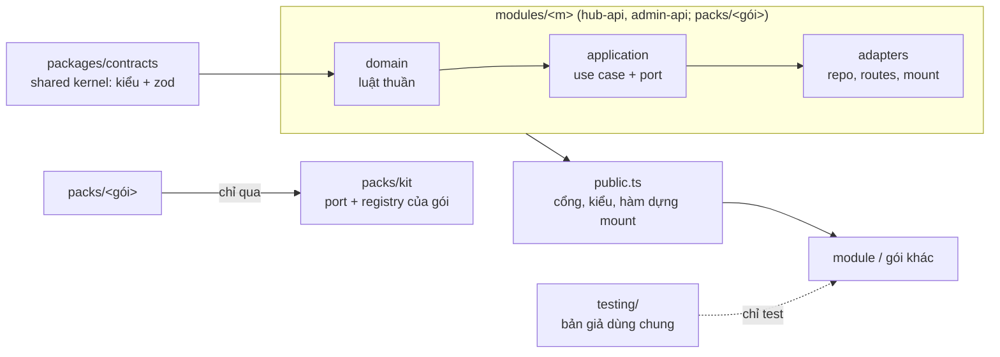

# Kiến trúc nền tảng (một nguồn)

Cập nhật 2026-11-08 (hết đợt CR-122 đuôi, CR-123, CR-124, CR-125, arch a1–a10). Code thắng tài liệu khi lệch. Tài liệu cũ `platform/modules.md` chỉ còn **bảng đóng băng/mở khoá module** (không phải kiến trúc).

## 1. Lớp và cửa module

- **Ba lớp mỗi module** (ADR-0023): `domain` (thuần, chỉ built-in) → `application` (use case, port; được import `packages/contracts`) → `adapters` (repo SQL, route, mount). Phụ thuộc chỉ hướng vào trong.
- **Cửa module (ADR-0037):** module khác chỉ import `modules/<m>/public.ts` (xuất theo tên: cổng, kiểu, hàm dựng mount; không `export *`). Gói không chạm ruột hub: `packs/<gói>` chỉ qua `packs/kit/public.ts` (port + registry), và gói khác chỉ qua `packs/<gói>/public.ts`. Miễn: `app.ts`, `*.mount.ts`, file test.
- **Bản giả:** `modules/<m>/testing/` và `packs/<gói>/testing/` (vd `packs/contracts/testing`) là cửa cho int test dựng gói khác; code production không import `testing/` (`no-prod-import-testing`).
- **Shared kernel `packages/contracts`:** chỉ kiểu + zod, không I/O, không db/apps (luật `contracts-only-zod`, `contracts-pure`). Mọi lớp được import nó.

## 2. Cưỡng chế (máy kiểm, không dựa kỷ luật)

| Cổng | Chạy ở | Làm gì |
|---|---|---|
| `.dependency-cruiser.cjs` | `bun run depcruise` (đợt/CI, ~21 s ấm) | luật lớp (`ca-*`), `cross-module-deep/flat`, `platform-no-pack-internals`, `no-prod-import-testing`, `contracts-*`, `component-no-fetch`, vòng |
| `.dependency-cruiser-known-violations.json` | baseline | **15 mục, toàn DLC (của Rowan)**; chỉ được co lại, ngoài DLC = 0 |
| `bun run check:boundaries` | pre-commit, `check`, CI | quét regex < 1 s; đỏ khi có vi phạm mới (ADR-0037) |
| `depcruise:affected --budget=20` | pre-commit (lefthook) | chỉ file đổi + cache; vượt 20 s thì dừng, ghi rõ |
| `bun run check:modules` | pre-commit khi đụng `packages/contracts/src/modules/**`, `check` | index sinh còn mới, mọi node.ts có trong module.ts, chạy luật thuần `moduleIssues` |
| `slice:merge` | cuối mỗi lát | `check:boundaries` rồi `check:modules`, `openspec:check`, rebase tự giải `tests/.lock` |
| `moduleRegistry.verify` | **lúc hub khởi động** (`packs.mount.ts`) | thiếu binding ⇒ hub không lên, in từng lỗi `MOD_*` bằng tiếng Việt |

DLC: chỉ giữ cửa tích hợp (`bun run dlc:check`), không sửa (xem `dlc-integration.md`). Quy ước gói↔lõi: `pack-boundary.md`, ADR-0031.

## 3. Module tính năng (CR-125): một khoá node, ba phần

Thêm một node trên sơ đồ flow = **một thư mục mỗi tầng**, không sửa file chung. Nguồn: [`specs/CR-125/spec.md`](../specs/CR-125/spec.md).

| Phần | Chỗ | Nội dung |
|---|---|---|
| Khai báo | `packages/contracts/src/modules/<app>/<node>/node.ts` (+ `module.ts` của app, `index.generated.ts` tự sinh) | `FeatureNodeDecl`: `key`, `label`, `kind` (`base`/`app`), **cổng zod vào/ra** (`configPort`, đầu ra), **`exits`** (lối ra: Ký xong / Từ chối / Hết hạn…), **`requires`** (vd Ký số cần Duyệt ngay trước), **`menu`** (mục + thứ tự ở menu «+» và palette), **`feature`** (cổng tính năng) |
| Xử lý máy chủ | `apps/hub-api/src/modules/packs/<app>/nodes/<node>/binding.ts` | `NodeBinding` (tool, validator, `options_path`, schema args = **chính** `configPort.schema`) và `EventBinding` (bộ đọc dữ kiện, xử lý kết quả) đăng ký vào **sổ module của kit** (`packs/kit/adapters/module-registry.ts`, cổng `kit/application/module.ports.ts`, xuất `kit/public.ts`). Gói không import engine |
| Panel cấu hình | `apps/admin-web/src/features/processes/modules/` | **panel chung** dựng từ `configPort` (`generic/GenericPanel.tsx`, gợi ý ô `widgets`) hoặc **panel riêng** đăng ký ở `panel-registry.ts` (vd `contracts/esign/Panel.tsx`) |

- **Kiểm lúc khởi động và CI:** `moduleIssues` (luật thuần) × binding thật. Mã lỗi: `MOD_DUP`, `MOD_UNBOUND`, `MOD_TOOL_MISSING`, `MOD_PORT_MISMATCH`, `MOD_EVENT_UNBOUND`, `MOD_OUTCOME_UNBOUND`, `MOD_OUTPUT_UNBOUND`, `MOD_ORPHAN_BINDING`, `MOD_SIGNAL_ORPHAN`, `MOD_INDEX_STALE`. Khai báo mà thiếu xử lý ⇒ dừng ngay, không đợi người dùng gặp lỗi.
- **Một nguồn:** menu «+», palette, panel, luật «cần bước trước», trần bước đều **đọc từ khai báo** (đã bỏ danh sách cứng `FE_NODES`).
- **Tự nối đầu vào (`modules/auto-map.ts`):** khi đặt node, mỗi cổng vào có đúng một nguồn cùng khoá + kiểu (đầu ra «Bắt đầu khi» hoặc bước trước) thì nối luôn; nhiều nguồn hoặc không có thì hỏi bằng câu nghiệp vụ. Đầu ra chạm run-state (Ký số, Gửi đối tác) ghi vào output bước chờ để bước sau đọc (`flow-runtime.md`).
- **Công cụ:** `bun run module:new <app> <node>` dựng `node.ts`, `node.test.ts`, cập nhật `module.ts`, chạy `module:index`, in đường dẫn `binding.ts` và panel tuỳ chọn cần tự viết; `bun run module:index` sinh lại index.
- **Node đã chuyển:** Ký số (`contracts.esign`), Gửi đối tác xác nhận (`contracts.partner-send`, node đầu tiên làm mới theo khuôn), Hiện bài (`community.show-post`), các bước cơ bản `core`.

### Node mới của quy trình dài (CR-126, 2026-11-08)

| Node / khoá | Cổng vào → lối ra | Tầng chạy (runtime) | Tầng giao diện |
|---|---|---|---|
| `core.subprocess` «Quy trình con» (base, executor `subprocess`) | vào: `def_key`, `input_map`; ra `done` (+ `outcome`, `sub_<trường>`) / `rejected` / `cancelled` (rẽ qua `branches`) | hub `processes/nodes/subprocess/*` (mở MỘT lượt con, canh chốt, huỷ cha ⇒ huỷ con, lỗi con ⇒ `tool_failed`); chặn vòng `SUBPROCESS_CYCLE`, sâu ≤ 3, `SUBPROCESS_NOT_FOUND` | admin-web: panel chọn quy trình + ánh xạ + rẽ nhánh |
| `core.start-form` «Phiếu yêu cầu» (base, stage ĐẦU) | vào: cấu hình phiếu (zod); ra: dữ liệu phiếu + tên yêu cầu làm đầu vào lượt | `hub-admin/process-start.ts` mở lượt từ phiếu (không cần sự kiện app); sai cấu hình ⇒ `START_FLOW_OFF` | workspace-web: form «Tạo yêu cầu» + tệp đính kèm; admin-web: editor phiếu |
| Duyệt `after.parallel` (trên stage `approve`) | mỗi nhóm một thẻ duyệt cùng lúc; luật `all` / `any` / `min`; ra như Duyệt thường | hub: khoá lượt khi đếm phiếu, index thẻ mở theo nhóm (migration 0128) | thẻ duyệt hiện từng nhóm + tiến độ |
| `contracts.create-from-step` «Tạo HĐ từ hồ sơ» | **chưa gộp vào `platform/gd0` tại thời điểm viết** — cập nhật khi lát `contract-from-step` merge | — | — |

- **Quy ước:** phần chạy (trạng thái run, khoá, canh chốt) thuộc hub-api; contract/zod và UI thuộc `packages/contracts` + admin-web/workspace-web. Thẻ «bước làm việc» (form-step-card) và «bước trong yêu cầu» (request-steps) chỉ là hiển thị của cùng dữ liệu run.
- **File theo lượt:** bảng nối `hub.process_run_files (process_run_id, attachment_id)` (migration 0130, RLS tenant). Quyền đọc tệp = quyền xem lượt (`process_run_viewer`); tệp phiếu đi theo vào lượt con; sweeper «chưa gắn quá 24 h» bỏ qua tệp đã có liên kết.
- **Toàn quyền duyệt thay (owner-override):** MỘT luật chung `packages/contracts/src/flow/owner-override.ts` (`ownerAlsoGroups` / `withOwnerOverride`); `compileDef` (đường khe) và `flow-launch` (flow theo sự kiện) cùng dùng — không còn hai bản.
- **RLS Hub + chốt chặn:** migration hub 0127 bật RLS 9 bảng còn hở; `apps/hub-api/src/lib/db-guard.ts` gọi khi mở DB, từ chối chạy bằng role superuser/BYPASSRLS/chủ bảng; test RLS suy từ catalog + `HUB_RLS_ALLOWLIST`.
- **Kick lỗi ⇒ `start_failed`:** lượt vừa mở mà kick lỗi ở bước đầu (chưa stage nào chạy) ⇒ `needs_decision{reason: start_failed, code}` với Thử lại / Huỷ, thay vì treo `pending`; lượt đã chạy giữ cho vòng nền.

## 4. Sơ đồ canvas và PDF (quyết định liên quan)

- Bố cục sơ đồ flow: **elkjs** `layered`, hướng Ngang/Dọc (`ui.dir`), chunk lazy, worker phục vụ tĩnh (`/static/elk/elk-worker.min.js`) — [ADR-0040](../adr/0040-elkjs-canvas-layout.md).
- Ảnh trang đầu PDF cho email Mời ký: `@napi-rs/canvas` + `unpdf` — [ADR-0041](../adr/0041-napi-canvas-pdf-thumbnail.md). Ghép ảnh vào PDF: [ADR-0039](../adr/0039-pdf-lib-ghep-anh.md).
- Mô hình flow theo sự kiện: [flow-model.md](flow-model.md), [ADR-0038](../adr/0038-flow-trigger-model.md).
