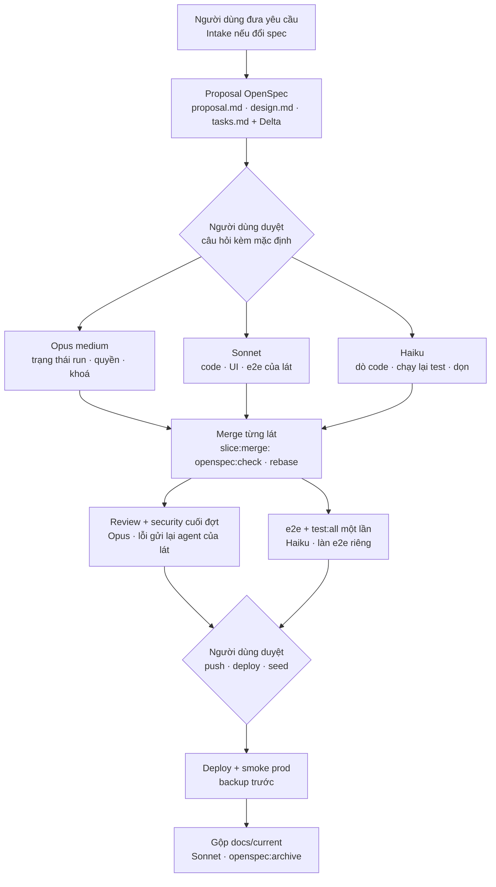

# Dây chuyền làm việc hiện tại (phiên chính ↔ agent ↔ worktree)

Cập nhật 2026-10-30 (sau đợt CR-103). Luật gốc: `CLAUDE.md` Luật 0, 0b, 0c; chi tiết: `docs/WORKFLOW.md`, ADR-0032 (OpenSpec Delta).

## Các bước
| # | Bước | Ai | Đầu ra / cổng |
|---|---|---|---|
| 1 | Nhận yêu cầu; thay đổi spec ⇒ Intake (Luật 0) | phiên chính | phân loại, câu hỏi |
| 2 | Proposal kiểu OpenSpec | phiên chính (+ `Explore` Haiku dò code trước) | `docs/specs/<change>/proposal.md`, `design.md`, `tasks.md` có Delta; dòng `CR-xxx` |
| 3 | Duyệt proposal | **người dùng** | câu trả lời ghi vào proposal ("Quyết định") |
| 4 | Chia lát, chạy song song, mỗi lát một worktree (`slice:new`, làn e2e riêng) | Opus / Sonnet / Haiku theo Luật 0c | code + test tối thiểu (Luật 0b) + Delta của lát |
| 5 | Merge lát | phiên chính | `slice:merge` (rebase, `openspec:check` đỏ ⇒ từ chối) |
| 6 | Review + security trên diff gộp; e2e + `test:all` một lần | Opus (review), Haiku (chạy test) | lỗi ⇒ gửi lại đúng agent của lát (`SendMessage`) |
| 7 | Duyệt push / deploy / seed | **người dùng** | không tự deploy (Luật 2b) |
| 8 | Backup → deploy → smoke prod | phiên chính (+ Haiku chạy script smoke) | `deploy.ps1`, script smoke |
| 9 | Gộp cuối đợt | Sonnet (docs-architect) | `docs/current/**`, `openspec:archive`, CR "Đã làm", STATE |

## OpenSpec ở đây khác gì OpenSpec gốc
- Không cài CLI; dùng định dạng Delta (`### ADDED|MODIFIED|REMOVED <file>` + `#### Yêu cầu` + `- Kịch bản:`) và bộ kiểm riêng `openspec:check|pending|archive` (ADR-0032).
- "Change" lớn = thư mục proposal (vd `docs/specs/flow-node-registry/`); mỗi lát có `tasks.md` + Delta riêng; nguồn sự thật hành vi = `docs/current/**` sau khi gộp.
- Còn thiếu (đề xuất): mỗi `- Kịch bản:` chưa trỏ tới test kiểm nó ⇒ chưa phát hiện được kịch bản không có test (CR-103: e2e chỉ kiểm "dòng có hiện" nên lọt lỗi If). Hướng sửa: thêm mã test vào kịch bản và để `openspec:check` cảnh báo khi thiếu.

## Khác gì AI SDLC (DLC)
| | Dây chuyền này | AI SDLC / DLC |
|---|---|---|
| Là gì | Cách Claude Code xây chính repo này | Tính năng sản phẩm: engine ngoài (`HUB_DLC_URL`, Keycloak realm `dlc`), hub-api chỉ là BFF đọc; đang **đóng băng** (`docs/platform/modules.md`) |
| Chạy ở đâu | Phiên Claude Code + subagent + git worktree trên máy dev | Agent `dlc` + đội vai (PM, Architect, Dev, QA, Reviewer) trong agent-runtime |
| Giai đoạn | Song song theo lát; cổng = người dùng duyệt + `openspec:check` + test | Tuần tự: Scope sign-off → Setup & Plan → Blueprint/Spec → Architect → Implementation → Code review ↺ → Testing ↺ → UAT → Release (bug: Intake → Code reading → Fix) |
| Bàn giao | Delta trong `tasks.md`, commit, báo cáo ≤ 10 dòng | JSON `STEP_DONE` giữa giai đoạn; tri thức vào KnowledgeHub |
| Model | Theo rủi ro (Luật 0c) | Theo vai của engine |

Hai thứ cùng hình dạng (giai đoạn + cổng + vai) nhưng khác mục đích: dây chuyền này để đội Claude làm repo; AI SDLC là sản phẩm bán cho khách chạy SDLC của họ.
